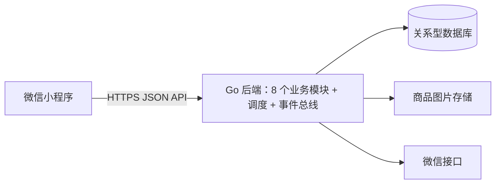
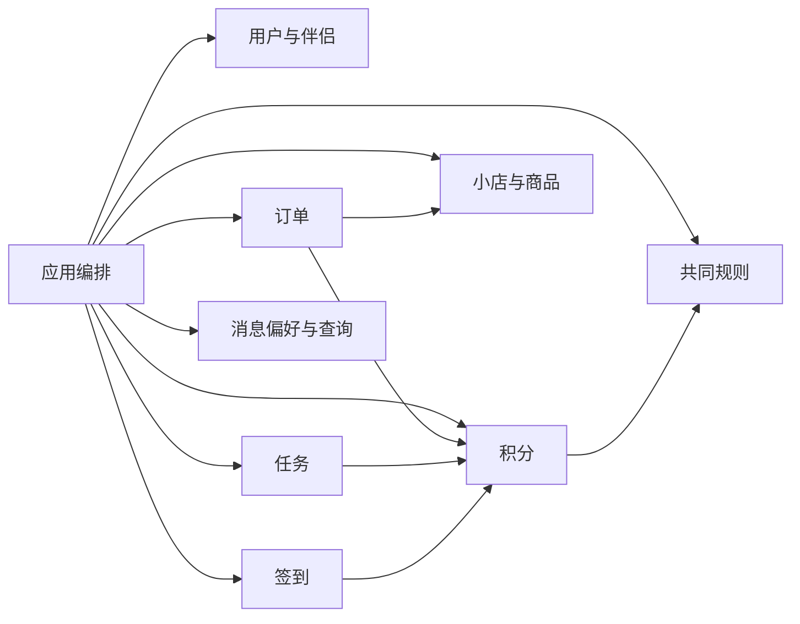
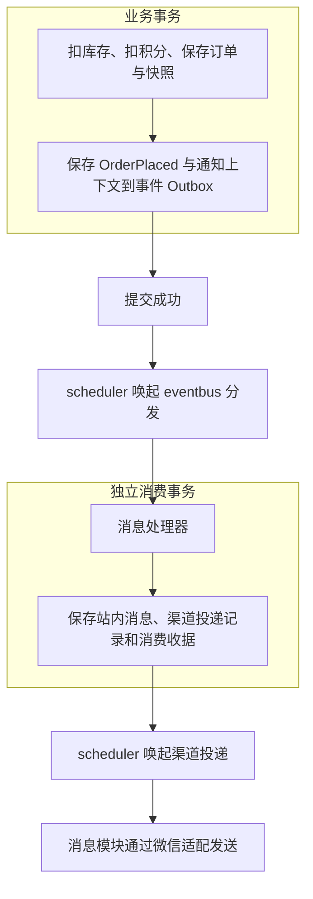

# 情侣小店开发规格

版本：2026-10-21 需求基线候选版，已补充本轮评审确认，等待整体确认。UI 采用已选择的 A「双人签到台」。本文收敛逐项确认的需求；访谈过程见 [requirements.md](requirements.md)，积分池取舍见 [ADR-0001](adr/0001-personal-points-and-shared-task-pool.md)。

## 1. 产品边界

- 当前服务对象为用户及妻子，通过微信小程序体验版使用，自建后端部署在用户服务器。
- 永久无真实金钱，不做支付、充值、提现、购买积分或付费会员。
- 双方角色对等，各自经营一家店，在伴侣店内下单，由店主兑现。
- 一次性邀请码绑定；第一版无解绑、换绑。
- 绑定后，一方提出共同规则、另一方确认，再开放积分、任务及下单。每日获得上限的制定和修改需双方确认，确认后立即生效。
- 暂不增加公开市场、陌生人社交、纪念日、预约、重复任务等未要求的功能。后期补充少量系统封面素材，不生成预置商品。

## 2. 页面与 UI

视觉基准：[A 首页大图](ui/images/home-detail-v2.png)、[页面总览](ui/images/screens-overview-v3.png)、[DESIGN.md](../DESIGN.md)。

| 页面 | 主要内容 |
| --- | --- |
| 首页 | 双人签到、共同积分池、个人余额与今日获得额度、待办、累计双人签到里程碑 |
| 任务 | 共同任务与伴侣任务，创建、接受、提交完成、确认、驳回补正、取消及历史 |
| 购物 | 伴侣小店、商品、页内购物车与单商品下单，无独立购物车 Tab |
| 我的 | 个人信息与积分、订单、自己小店管理、伴侣设置、共同规则、消息通知 |

图中人物、昵称、商品及积分数据是示例。真实商品初始为空，个人初始余额为 0，示例中的每日上限 100 不是系统固定值。

## 3. 积分与签到

### 3.1 区分三个数

- **个人余额**：可兑换商品的积分，初始 0；罚分可使余额为负。负余额时任何商品都不能下单，包括 0 积分商品。
- **个人每日获得额度**：任务奖励与伴侣赠送实际到账之和的日上限，两人采用相同数值，各自独立累计。签到和订单退分不计入。
- **积分池**：任务奖励预算，初始 100；区分可用积分与任务已预留积分。

积分统一以整数记录和结算，出现小数时四舍五入取整；赠送上限、订单取消罚分和任务超时罚分均采用这一口径。

商品价格、每日获得上限、任务奖励和申请赠送金额均允许为 0，禁止负数输入；先检查输入非负，再按统一口径取整，不能将负数取整为 0 后放行。库存使用非负整数，只有至少一份库存时才能下单。个人余额仍可按已定罚分规则为负。

每日获得上限为 0 是有效规则，此时任务和赠送实际到账均为 0；签到入池、退款及用已有余额下单照常按各自规则处理。首次规则是否确认按规则生效状态判断，不以其数值大于 0 判断。

上限修改不重置当天已获得积分或赠送次数，不追回已有余额；剩余获得额度最低为 0。

签到、每日获得额度与赠送次数统一按北京时间（Asia/Shanghai）自然日统计，以 00:00 为日界线，不受手机或服务器时区影响；这不改变共同规则确认后立即生效的约定。

### 3.2 系统固定签到规则

- 每人每天签到一次，每次池子 +10。
- 双方同日都签到，池子再 +10；双人当日合计 +30，不含里程碑。
- 统计累计双人签到天数，漏签不清零。

| 累计双人签到 | 额外入池 |
| --- | ---: |
| 7 天 | 30 |
| 30 天 | 100 |
| 100 天 | 300 |
| 365 天 | 1000 |

每档只奖励一次。基础与里程碑规则由系统固定，双方不能自行调整。全部签到积分入池，不增加个人余额或占每日获得额度。

### 3.3 伴侣赠送

- 由系统新增积分，不扣赠送方余额或池子。
- 每人每天最多赠送 3 次，单次赠送上限为接收方每日获得上限的五分之一四舍五入取整。例如每日上限为 103，单次最多赠送 21。
- 按接收方当天剩余额度到账，超出部分消失，不入池、不保留以后领取。
- 申请金额允许为 0，每笔赠送均计一次，包括主动赠送 0 分、部分到账或实际到账为 0；第四次赠送仍拒绝。
- 每日上限为 0、1 或 2 时，单次赠送上限取整为 0，允许提交 0 分赠送并正常计次。0 分赠送保留业务记录和结果通知，不增加余额或今日已得。

### 3.4 收支去向

| 场景 | 处理 |
| --- | --- |
| 商品消费 | 个人扣分，积分退出系统，不入店主余额或池子 |
| 拒单、有效取消订单 | 原额退还订单实扣积分，不计每日获得额度 |
| 任务奖励 | 从池子预留支出，按各人剩余日额度到账 |
| 任务奖励超额 | 未发出的预留积分释放回池子，不补发、不重复增加池子总额 |
| 取消订单或任务超时罚分 | 从责任方余额扣除并立即全额入池，可扣负；后续补回个人负余额时不重复入池 |

### 3.5 共同规则提议与生效

- 同一伴侣关系可有多份待确认提议；每份固定提出人、提议时生效上限和新上限，确认明确指向该份提议，只能由提出人的另一方操作。改变提议内容时另建提议，不覆盖原内容。
- 任一份提议获确认时，在同一事务中使其生效，并将该关系其余待确认提议全部标为已作废、移出待办；历史记录和原通知保留。此规则同时适用于首次确认和后续修改。
- 同时确认不同提议时，先成功提交的一份生效，其余确认返回提议已作废并展示当前规则，不能再次覆盖生效上限。
- 未认可现有提议时，任一方可另提方案；在另一方确认前，已有生效规则继续适用，首次确认尚未完成则继续保持业务门禁。

## 4. 商品、库存与订单

### 4.1 商品与下单

- 双方自行创建商品，不提供预置商品；封面图片必选。
- 店主自定积分价，允许 0；商品需有库存。
- 购物车位于购物页内部、可暂存多个候选商品，加入时不占积分或库存；每次仅选一个商品一份下单，无数量选择、多选或合并结算。
- 下单同时扣订单积分与一份库存，正价须余额足够，不允许下单透支。
- 购物时反复校验当前价格、库存和个人余额，刷新时机见第 8.7 节。下单请求携带用户本次确认的积分价，服务端在下单事务内核对当前价格；不一致时不创建订单、不扣分或库存，返回最新信息供重新确认，不能静默按新价成交。
- 下单前先处理该关系已经到期的伴侣任务，再以结算后的余额判断下单资格。余额或库存不足时拒绝下单并刷新状态；价格相同也不能沿用页面上的旧余额。
- 下单时保存商品快照，包含商品名称、封面、描述/兑现说明及下单时积分价；订单展示和兑现以快照为依据，后续商品编辑不改变已有订单的约定。
- 订单锁定下单时实扣积分，后续商品改价不影响退款与罚分。
- 拒单或有效取消退回一份库存；正常完成不恢复。0 积分商品同样占库存。

### 4.2 正常流程

下单 → 待接单 → 店主接受 → 待兑现 → 店主提交已兑现 → 待确认收货 → 下单方确认或 3 天自动确认 → 完成。

下单方可驳回兑现，回到待兑现，本轮自动确认失效；店主再次提交后重新计算 3 天。

接单后，待兑现和待确认收货的取消申请采用相同流程：先等待店主处理，待处理期间不提交已兑现，也不自动完成。店主同意后按取消规则原额退分、退库存；拒绝则恢复申请前状态：原为待兑现的继续待兑现，原为待确认收货的从拒绝时重新计算 3 天。

### 4.3 拒绝与取消

| 操作 | 权限 | 积分和库存后果 |
| --- | --- | --- |
| 店主拒单 | 接单前直接拒绝 | 原额退分、退一份库存，不罚 |
| 下单方取消 | 接单前直接取消 | 原额退分、退一份库存，不罚 |
| 下单方申请取消 | 接单后、完成前，需店主同意 | 同意后原额退分、退一份库存，下单方不罚 |
| 店主取消 | 接单后、完成前直接生效，无需下单方同意 | 原额退分、退一份库存；另扣店主订单实扣积分的 50%，四舍五入，罚分入池、可扣负 |

订单实扣 21 时，店主取消罚 11；之后商品改价为 100 也不改变此结果。所有退分均不受每日获得额度影响。

## 5. 任务

### 5.1 类型与预留

| 类型 | 完成人 | 奖励约定 | 时间 |
| --- | --- | --- | --- |
| 伴侣任务 | 创建者的伴侣 | 执行方奖励 | 创建时选择未来绝对 deadline |
| 共同任务 | 双方 | 每人相同的奖励 | 不限时 |

不允许给自己创建个人任务。两类任务发布时均足额预留奖励，池子不足不能发布；共同任务按两人奖励之和预留。

任务奖励允许为 0，此时预留为 0，池子可用为 0 也可发布。0 分任务仍须接受、提交和确认，适用的超时罚分为 0，正常保留状态变化、业务历史及对应通知。

双方都需要另一方接受后开始。拒绝则结束、全部预留退池，不罚。伴侣任务未接受就到期也结束退池，不罚；接受不顺延 deadline。

接受前发布方可编辑内容、奖励和未来 deadline，奖励变化同步补足或释放预留差额，池子不足不能提高奖励。接受后锁定内容、奖励和原 deadline；想改变约定需双方取消后重发。驳回补正另设 deadline 的流程保留。

接受前的编辑不增加版本核对或重新确认流程。

### 5.2 完成与结算

- 伴侣任务：执行方提交完成，创建方确认后结算。
- 共同任务：一方提交完成，另一方确认后双方一起结算。
- 提交完成本身不发分。每人按自己当天剩余额度结算，超额退池。
- 共同任务的约定奖励相同，实际到账可不同。例如约定每人 20、一方剩余 10 另一方剩余 50，则到账分别为 10、20，未发出的 10 退池。

### 5.3 Deadline、驳回与超时

- 使用绝对 deadline，不使用可暂停的小时倒计时。选择 10:00 即为 10:00:00，提交须严格早于截止时刻；恰好到达该时刻已算到期，不将整分钟视为宽限期。
- 截止前提交完成后处于待确认，不因另一方未及时确认而自动超时。
- 确认方可驳回，驳回后恢复未完成、不发奖励。
- 伴侣任务驳回时必须指定晚于当前时间的补正 deadline。及时重新提交后继续待确认；补正到期未提交，按相同超时规则处理。
- 共同任务驳回后仍不限时，不设补正 deadline，保留预留积分供重提。
- 已接受的伴侣任务超时后结束、不能再提交，预留积分退池；执行方另扣约定任务奖励的 50%，四舍五入、可扣负，罚分入池。
- 超时保留任务、退池和罚分历史，不物理删除。
- 到期结束、预留释放及适用罚分从有效 deadline 起生效，后台晚处理或服务重启不顺延这一时刻。到期后不能通过接受、编辑 deadline、提交或同意取消来改变已发生的到期结果；及时提交进入待确认的例外保持不变。相关查询及后续业务操作必须先补齐到期结算，具体事务顺序见第 8.3 节。

### 5.4 主动取消

- 发布后、结算前任一方可申请取消，另一方同意后取消，未发放预留积分全额退池，不罚分。同一任务最多一份待处理取消申请；已有申请时展示该申请，由申请人的另一方同意或拒绝，不新建第二份。
- 取消申请独立于任务主阶段，不冻结原有操作。接受前仍可按权限编辑、接受或拒绝任务；开始后仍可提交完成，待确认时仍可确认或驳回完成。申请不改变 deadline；尚未提交完成的已接受伴侣任务仍可能到期受罚，已待确认的任务仍不自动超时。
- 拒绝取消只关闭该申请，保留处理时的最新任务阶段和当前有效 deadline，不恢复申请时的旧状态。例如申请取消后已及时提交完成，拒绝取消后仍待确认；期间如已驳回完成并设置补正期限，拒绝取消也不能恢复旧期限。
- 若任务先完成、被拒绝接受、到期或超时结束，待处理取消申请同步失效，后续不得再同意或拒绝该申请。若先同意取消，则任务结束，后续完成确认等操作失效；按服务端状态及截止时刻只允许一个合法结束结果。

## 6. 消息

### 6.1 已定渠道规则

- 有站内消息中心，保存已投递通知、未读状态和历史。
- 每种产生消息的业务动作定义具体模板，按详细模板设置，不仅按业务大类设置。
- 每个人管理自己的接收偏好：仅站内、仅微信、双渠道、全部关闭。
- 所有模板默认站内开启、微信关闭；微信仍需接收方订阅机会与可用的平台模板。
- 设置只影响后续新消息，不删除、更改或补发历史消息；业务历史、积分结算不受通知开关影响。
- 站内开启时，微信未发送不影响之后打开小程序查看已有站内通知。

### 6.2 消息清单的统一口径

以下 30 个内部业务消息模板已由用户基本确认；微信平台模板映射仍待实际接入验证。每个编号对应一个独立接收偏好，表格按业务分组仅用于阅读，不合并为大类开关。同一动作在任务类型、接收人角色或订单状态上的差异使用正文分支。

- 通知发给需要接手处理的人，或受到对方、系统操作结果影响的人。操作者通常只看当前页面的成功反馈；共同任务结算和本人实际被扣罚时，也向本人发送结果通知。系统自动结束的订单或任务通知双方。
- 表中“发送”均指业务动作成功后，按每个接收人该模板的渠道偏好投递。失败操作、无实际变更的保存、请求重试不产生新的业务消息。
- 同一业务事件、同一接收人、同一模板只生成一条逻辑消息。双渠道投递或发送重试不新增站内消息；正常重提兑现、重提任务完成等新的业务事件可以再次通知。
- 退款、任务到账、罚分和相关预留释放并入对应业务结果消息，不再额外发送通用“积分变动”通知。积分流水和业务历史独立保存。
- 模板中的积分采用实际结算结果；商品名称取订单商品快照，任务名称与其他正文数据保留事件发生时的值。消息标明发生时间，时间统一使用北京时间；任务截止时间显示完整日期和时分秒，自动确认时间显示完整日期和时分。
- 通知可以在业务提交后异步生成，使用业务发生时已保存的有效渠道偏好和结果快照；消费时不重新读取当前偏好来决定历史事件是否通知。
- 历史消息正文不因商品改名、任务编辑或后续状态改变而重写。点击后展示业务当前状态；已处理的事项不再提供失效操作。首页待办按业务状态生成，不受通知开关影响。
- 下表文案为站内正文基准。微信渠道需另行匹配实际可用模板并适配字段，不承诺原文逐字发送；微信不可投递时，不擅自改成用户未开启的站内渠道。

### 6.3 订单消息

所有订单消息跳转对应订单详情；待处理操作仅在订单当前状态允许时出现。

| 编号 / 模板名称 | 触发动作 | 接收人 | 标题与正文模板 |
| --- | --- | --- | --- |
| O01 新订单待接单 | 下单成功，积分和库存扣减完成 | 店主 | **你有新订单**：{下单方}兑换了《{商品名}》，实扣 {订单积分} 积分，请接单或拒绝。 |
| O02 订单已接单 | 店主接受订单 | 下单方 | **订单已接单**：{店主}已接受《{商品名}》订单，等待兑现。 |
| O03 订单被拒绝 | 店主在接单前拒单，退款和退库存完成 | 下单方 | **订单未被接受**：《{商品名}》订单已被{店主}拒绝，已退还 {退还积分} 积分。 |
| O04 下单方直接取消 | 下单方在接单前直接取消，退款和退库存完成 | 店主 | **订单已取消**：{下单方}取消了《{商品名}》订单，已返还 1 份库存。 |
| O05 订单待确认收货 | 店主提交或重新提交已兑现 | 下单方 | **请确认兑现结果**：{店主}已提交《{商品名}》的兑现结果，请确认或驳回；本轮将于 {自动确认时间} 自动确认。 |
| O06 兑现被驳回 | 下单方驳回兑现，订单恢复待兑现 | 店主 | **兑现结果被驳回**：{下单方}驳回了《{商品名}》的兑现结果，请继续兑现后重新提交。 |
| O07 下单方确认收货 | 下单方主动确认收货 | 店主 | **订单已完成**：{下单方}已确认《{商品名}》的兑现结果，订单完成。 |
| O08 订单自动完成 | 有效的 3 天期限届满，系统自动确认成功 | 双方 | **订单已自动完成**：《{商品名}》订单已自动确认收货。 |
| O09 订单取消待处理 | 下单方在接单后申请取消 | 店主 | **请处理取消申请**：{下单方}申请取消《{商品名}》订单，请同意或拒绝；申请待处理期间订单不会自动完成。 |
| O10 订单取消获同意 | 店主同意取消，退款和退库存完成 | 下单方 | **取消申请已同意**：{店主}已同意取消《{商品名}》订单，已退还 {退还积分} 积分。 |
| O11 订单取消被拒绝 | 店主拒绝取消，恢复申请前状态 | 下单方 | **取消申请未获同意**：{店主}未同意取消《{商品名}》订单。原为待兑现时附“订单继续待兑现”；原为待确认收货时附“本轮将于 {新的自动确认时间} 自动确认”。 |
| O12 店主主动取消 | 店主在接单后直接取消，退款、退库存及罚分结算完成 | 下单方；罚分大于 0 时也通知店主本人 | 下单方收到 **店主取消了订单**：{店主}取消了《{商品名}》订单，已退还 {退还积分} 积分。店主收到 **订单取消扣分**：你取消了《{商品名}》订单，本次扣除 {罚分} 积分并入池，扣后余额为 {扣后余额}。 |

0 积分订单在退款类消息中使用“本单为 0 积分，无需退分”。店主同意下单方的取消申请不产生主动取消罚分；O12 的店主本人通知仅对应实际罚分，不额外生成第二条罚分消息。

### 6.4 任务消息

所有任务消息跳转对应任务详情。“另一方”始终相对于当前动作的发起人，不固定指创建方；共同任务的完成确认人是提交人的另一方。

| 编号 / 模板名称 | 触发动作 | 接收人 | 标题与正文模板 |
| --- | --- | --- | --- |
| T01 新任务待接受 | 发布任务成功并完成奖励预留 | 创建方的伴侣 | **有新任务待接受**：伴侣任务为“{创建方}邀请你完成《{任务名}》，奖励 {约定奖励} 积分，截止 {截止时间}，请接受或拒绝”；共同任务为“{创建方}邀请你一起完成《{任务名}》，每人奖励 {约定奖励} 积分，不限时，请接受或拒绝”。 |
| T02 待接受任务已更新 | 创建方在接受前成功保存内容、奖励或 deadline 的实际变更 | 创建方的伴侣 | **任务已更新**：{创建方}更新了《{任务名}》，请查看最新内容。附最新奖励；伴侣任务附最新截止时间，共同任务注明每人奖励和不限时。 |
| T03 任务已接受 | 另一方接受任务 | 创建方 | **任务已接受**：{伴侣}已接受《{任务名}》。伴侣任务附“截止 {截止时间}”；共同任务附“共同任务已开始，不限时”。 |
| T04 任务被拒绝 | 另一方拒绝接受，预留释放完成 | 创建方 | **任务未被接受**：{伴侣}拒绝了《{任务名}》，已释放 {预留释放积分} 积分回池，无罚分。 |
| T05 未接受任务到期 | 伴侣任务未接受即到期，任务结束并释放预留 | 双方 | **任务到期未被接受**：《{任务名}》已到期结束，预留的 {预留释放积分} 积分已释放回池，无罚分。 |
| T06 任务完成待确认 | 提交或重新提交任务完成成功 | 本次提交人的另一方 | **请确认任务完成**：{提交人}提交了《{任务名}》的完成结果，请确认或驳回；确认后按各人当日剩余额度结算。 |
| T07 任务完成被驳回 | 确认方驳回任务完成 | 本次提交人 | **任务需要补正**：{确认方}驳回了《{任务名}》的完成结果，请补正后重新提交。伴侣任务附“补正截止 {补正截止时间}”；共同任务附“仍不限时”。 |
| T08 任务完成结算 | 确认任务完成并成功结算奖励 | 伴侣任务的执行方；共同任务的双方 | **任务已完成**：《{任务名}》已确认完成，你的约定奖励为 {约定奖励} 积分，实际到账 {实际到账} 积分。未足额到账时附“因今日剩余额度不足，未到账的 {未到账积分} 积分已释放回池，不再补发”。 |
| T09 已接受任务超时 | 已接受的伴侣任务在原截止或补正截止前未提交，超时结束并完成退池、罚分 | 双方 | 执行方收到 **任务超时结束**：《{任务名}》已超时，预留的 {预留释放积分} 积分已释放回池；本次罚分 {罚分} 积分并入池，扣后余额 {扣后余额}。创建方收到同标题：任务已超时结束，预留的 {预留释放积分} 积分已释放回池，执行方罚分 {罚分} 积分已入池。 |
| T10 任务取消待处理 | 任一方成功申请取消任务 | 申请人的另一方 | **请处理任务取消申请**：{申请人}申请取消《{任务名}》，请同意或拒绝。若为已接受且尚未提交完成的伴侣任务，附“申请不顺延截止时间，仍需在 {截止时间} 前提交完成”。 |
| T11 任务取消获同意 | 另一方同意取消，任务结束并释放预留 | 取消申请人 | **任务取消申请已同意**：{另一方}已同意取消《{任务名}》，预留的 {预留释放积分} 积分已释放回池，无罚分。 |
| T12 任务取消被拒绝 | 另一方拒绝仍有效的取消申请，保留处理时的最新任务阶段及有效 deadline | 取消申请人 | **任务取消申请未获同意**：{另一方}未同意取消《{任务名}》，任务继续按当前约定进行。已接受且未提交的伴侣任务附当前有效截止时间；待确认任务注明继续等待完成确认；共同任务仍不限时。 |

- T02 只告知变更，不增加版本核对或重新确认流程；同一次保存同时修改多个字段只通知一次。
- T08 向每个接收人分别生成文案。“未到账积分”指该接收人的约定奖励减实际到账；共同任务另一方的到账数不混入本人的数据。实际到账为 0 时仍发送结算结果。
- T05 只适用于未接受的伴侣任务；T09 只适用于已接受且未及时提交的伴侣任务，发生时间取本次有效 deadline，实际处理和投递可以稍后。已提交完成、正在等待确认的任务不发送超时通知；共同任务始终没有到期或超时消息。
- T12 只关闭取消申请，不回退最新任务阶段或有效 deadline，不意味着拒绝任务完成，也不触发补正或罚分。任务先结束而使取消申请失效时，由对应结束消息表达结果，不再生成 T11 或 T12。

### 6.5 赠送与签到消息

| 编号 / 模板名称 | 触发动作 | 接收人 | 标题与正文模板 | 跳转 |
| --- | --- | --- | --- | --- |
| P01 收到伴侣赠送 | 赠送成功并完成到账、超额处理及赠送计次 | 接收方 | **收到伴侣赠送**：{伴侣}赠送了你 {赠送积分} 积分，实际到账 {实际到账} 积分。未足额到账时附“受今日剩余额度限制，超出的 {未到账积分} 积分未发放，不入池、不补发”。 | 该次赠送的积分记录 |
| P02 伴侣已签到 | 一方当天签到成功 | 签到人的伴侣 | 接收人尚未签到时为 **伴侣已签到**：{伴侣}今天已签到，积分池增加 10 积分，你今天还未签到。接收人已签到时为 **双人签到完成**：{伴侣}已签到，今天基础签到及双人奖励共 30 积分已入池，累计双人签到 {累计天数} 天。 | 首页双人签到台 |
| P03 双人签到里程碑 | 累计双人签到首次达到一档里程碑，奖励入池成功 | 双方 | **达成双人签到里程碑**：累计双人签到达到 {里程碑天数} 天，额外 {里程碑奖励} 积分已进入共同积分池。 | 首页签到里程碑 |

P01 即使主动赠送 0 分或实际到账为 0 也发送，赠送方在当前操作结果中看到到账情况和剩余赠送次数。赠送 0、到账 0 时不附额度不足文案。P02 合并该次签到及同日双人奖励，不再为双人额外 10 积分单独发送一条消息；其 30 积分不包含里程碑奖励。P03 是独立模板，同日达到里程碑时可与 P02 同时产生，双方各自按偏好接收。

### 6.6 绑定与共同规则消息

| 编号 / 模板名称 | 触发动作 | 接收人 | 标题与正文模板 | 跳转 |
| --- | --- | --- | --- | --- |
| R01 伴侣绑定成功 | 另一方使用邀请码成功完成绑定 | 邀请码发起方 | **伴侣绑定成功**：{伴侣}已与你绑定，接下来请共同确认使用规则。 | 伴侣设置 |
| R02 共同规则待确认 | 一方首次提出规则，或提出每日获得上限修改 | 提出人的另一方 | **请确认共同规则**：首次为“{提出人}提议将每日获得上限设为 {新上限} 积分，请确认”；修改时为“{提出人}提议将每日获得上限由 {原上限} 调整为 {新上限} 积分，请确认”。 | 对应规则提议 |
| R03 共同规则已生效 | 另一方确认，规则成功生效 | 规则提出人 | **共同规则已生效**：首次为“双方每日获得上限为 {新上限} 积分，现可开始使用积分、任务和下单功能”；修改时为“每日获得上限已由 {原上限} 调整为 {新上限} 积分，立即生效；今日已获得积分和已用赠送次数不重置”。 | 共同规则 |

完成绑定、确认规则的操作者在当前页面看到结果，不再重复接收 R01 或 R03。有其他待确认提议时，规则确认结果页及 R03 附“其余待确认提议已自动作废”，不为每份作废提议另发通知；旧 R02 打开后展示该提议已作废及当前规则，不再提供确认操作。首次规则生效后的初始池余额在首页展示，不额外发送“启动积分到账”消息。

### 6.7 不单独通知的动作与验收场景

以下动作保留必要的页面反馈和业务记录，不新增通知模板：

- 登录、生成邀请码、查看详情、标记消息已读、修改个人资料或通知偏好。
- 商品创建与日常维护、修改价格或库存、购物车加入和移除。
- 操作者自己的下单成功、接单成功、提交成功等一般操作反馈；第 6.2 节列明的个人结算和罚分通知除外。
- 订单退款、库存返还、任务预留与释放、罚分入池等已被业务结果消息覆盖的附带变化；任务发布或编辑使用 T01 / T02，不额外为预留变化生成消息。
- 本人的普通签到、独立的每日双人额外奖励、初始积分池赠送。

本轮不增加定时催签到、任务临期提醒、自动确认前提醒或反复催办。需要处理的事项继续保留在首页待办和对应业务列表。

实现时至少验证以下场景：

| 场景 | 应有消息结果 |
| --- | --- |
| 赠送 20、接收人当天剩余额度 0 | 接收人收到一条 P01，明确赠送 20、到账 0、未发放 20；不再生成积分变动通知。 |
| 共同任务每人奖励 20，双方分别剩余 10 和 50 | 双方各收到一条 T08，分别写到账 10 和 20；前者说明 10 退池，后者不误报超额。 |
| 订单实扣 21，后来商品改价 100，店主余额 5 时主动取消 | O12 给下单方写退还 21，给店主写扣罚 11、余额 -6；商品名来自订单快照，不另外发送退款或罚分通知。 |
| 待确认收货时申请取消，随后店主拒绝 | 申请时发 O09，拒绝时发 O11 并使用新的自动确认时间；待处理期间不发 O08，拒绝取消不额外发 O05。 |
| 任务按时提交，等待确认时越过原 deadline | 保留 T06，不产生 T09；只有后续补正期限届满且未重提时才可能产生 T09。 |
| 双人签到恰好达到里程碑 | 第二次签到发 P02 给另一方，P03 分别给双方；P02 的基础 30 与 P03 的额外奖励不重复计数。 |
| 重复请求、渠道重试或已结束事项的旧操作 | 不重复生成消息；失效操作不成功，也不产生对应结果通知。 |
| 接收人关闭某模板的全部渠道 | 不产生该人的新通知；业务结果、积分流水和待办照常更新，已有通知及未读状态不变。 |
| 主动赠送 0 分，或确认完成奖励为 0 的任务 | 按偏好生成 P01 或 T08，实际到账 0；不误报额度不足，赠送仍消耗一次次数。 |
| 取消申请后及时提交任务，再拒绝取消 | T12 表达继续等待完成确认，不提示重做，不生成 T07 或 T09。 |
| 一份规则提议生效，使其他待确认提议作废 | 只按本次生效生成 R03，旧 R02 正文保留、点击显示提议已作废，不再确认旧提议。 |

## 7. 进入实现前的确认与交付准备

核心业务边界已逐项确认，当前等待用户确认整份规格表达一致。后续实现不重新解释已定规则，也不增加未要求功能。

以下属于实现细化或实际接入准备，不将它们伪装成已经验证完成的结果：

- 商品与任务管理表单的最终字段、正式名称、双方称呼和真实素材待整理。
- 消息事件、接收人及模板已按第 6 节基本确认；微信平台模板映射与发送验证仍属于接入准备。
- 当前明确只服务用户和妻子，不扩大为公开运营；其他使用者范围若需要再确定。
- Taro、React、TypeScript、Go、HTTP 框架和数据库的最终实施方案待定，已有技术讨论不能冒充全部已确认。
- 微信账号、体验成员、订阅模板、域名与 HTTPS 需实际验证；当前没有接入凭据或部署结果。

UI 选择不意味着这些未定项已自动确认，也不意味着业务已经实现。

## 8. 架构与模块划分建议

本节为整体架构复核后的实施建议，尚未视为技术选型已获确认。按当前仅服务两人、单台服务器和后端单实例运行设计；服务器现有数据库及存储条件尚未调查。保留 8 个业务模块、2 个技术模块，通过应用编排和共享基础能力补齐初始化、依赖装配、可靠投递及运维流程。

### 8.1 整体形态

采用模块化单体：一个代码仓库，前端与后端分目录；后端划分 8 个业务模块，以及后台调度、事件总线 2 个技术模块，共 10 个主要模块，统一构建和部署为一个 Go 服务，使用同一个关系型数据库。必须一起完成的跨模块业务操作共用一次数据库事务，业务结果与领域事件一同保存，提交后由进程内事件分发器交给订阅者。

- 小程序建议采用 [Taro](https://github.com/NervJS/taro) + React + TypeScript，延续首页、任务、购物、我的四个 Tab。
- 后端建议采用 Go + [Gin](https://gin-gonic.com/en/docs/)，通过 HTTPS JSON API 提供业务能力。
- 数据库优先复用服务器现有可用的关系型数据库；没有现成数据库时建议 PostgreSQL。并发修改同一余额、预留或库存时使用事务内条件更新或行锁，具体实现随数据库确定；PostgreSQL 的行锁语义见[官方说明](https://www.postgresql.org/docs/current/explicit-locking.html)。
- 图片作为公共存储能力提供，初版可保存到服务器持久目录，通过受控接口访问；商品快照引用的图片需保持可用。数据库和图片一并纳入备份。
- 后台调度单独组织为 `scheduler` 模块，首版与 HTTP API 运行在同一个后端进程中；到期处理和消息投递依据数据库持久记录执行。
- 领域事件通过独立的 `eventbus` 模块写入事件 Outbox，与业务变更一起提交；提交后由事件总线在独立消费事务中调用消息处理器，分别保存通知和消费收据。事件分发和微信投递均由调度模块驱动。

### 8.2 八个业务模块与两个技术模块

| 模块 | 独占数据与主要职责 | 明确依赖 |
| --- | --- | --- |
| 用户与伴侣 `identity` | 微信身份映射、应用会话、个人资料、邀请码、固定伴侣关系 | 使用微信适配与会话存储，向应用编排提供可信身份和伴侣上下文；积分账户与空店由绑定用例协调初始化。 |
| 共同规则 `rules` | 首次规则确认、修改提议及其生效或作废、当前生效上限与业务开放状态 | 接收已校验的操作身份；提供规则只读接口，每日已得与赠送计次归积分模块。 |
| 积分 `points` | 个人余额、积分池、预留、每日获得额度、赠送次数、赠送记录和积分流水；统一四舍五入及各类收支处理 | 读取 `rules` 的当前有效上限；按业务对象标识处理预留、结算和退款，不反向调用订单、任务或签到。 |
| 签到 `checkin` | 每日签到、累计双人签到、里程碑记录，判定本次应得的入池奖励 | 调用 `points` 入池；签到及奖励在同一事务完成，返回签到和里程碑事件。 |
| 小店与商品 `catalog` | 小店、商品资料、库存、页内购物车；维护库存扣回规则 | 使用媒体存储能力管理封面引用，提供商品与库存服务；购物车只保存候选商品。 |
| 订单 `orders` | 订单状态、商品快照、接单、兑现、取消、自动确认和订单操作历史 | 调用 `catalog` 扣回库存、`points` 扣退积分及罚分，并保留快照媒体引用；决定订单合法状态转换。 |
| 任务 `tasks` | 两类任务、接受前编辑、接受、提交、补正、独立取消申请、有效 deadline 与任务操作历史 | 调用 `points` 预留、结算、释放和罚分；决定任务及取消申请的合法状态转换，提供到期结算入口。 |
| 消息 `notifications` | 30 个模板、路由到接收人、渠道偏好、订阅授权记录、站内消息和未读、渠道投递记录 | 消费中立事件契约和冻结的通知上下文，使用微信适配发送；提供只读偏好快照，渲染时不回读订单或任务的可变状态。 |
| 后台调度 `scheduler` | 周期唤起、作业超时、防止同类扫描重叠、运行记录与停止恢复 | 只执行启动装配注册的作业回调；到期判定、数据领取和结算由对应处理入口负责。 |
| 事件总线 `eventbus` | 事件 Outbox、订阅注册、按类型分发、每个订阅者的消费进度、重试和失败记录 | 使用数据库和中立事件契约，执行装配时注册的处理器；不导入具体业务模块。 |

首页是签到、积分、订单和任务的聚合展示；待办直接来自这些模块的当前业务状态，不额外维护一套独立待办状态。

**应用编排与启动装配**

应用编排属于代码分层，负责可信身份、首次规则门禁、请求幂等、事务边界以及首次绑定等跨模块用例。各模块的数据写入通过所属模块的服务方法完成；首页等只读聚合调用公开查询接口。

下图表示业务服务的调用依赖；媒体、微信、数据库等共享能力省略：

启动装配统一创建模块、注入依赖、注册消息事件处理器和后台作业。调度器运行时调用这些回调，不表示调度器代码需要导入订单或任务；事件总线同样只持有注册的处理器。领域事件契约放在中立的值类型包中，只包含标识、时间和结果数据，不引用业务服务或数据库仓储。

媒体存储、微信适配、事务管理、时钟等共享能力放在基础设施层，由调用方使用；基础设施不反向调用业务服务。这样业务调用、事件订阅和运行时调度各有明确的装配位置。

### 8.3 代码组织与一致性

接口层解析请求，应用用例确定操作身份与事务，业务模块执行规则并通过数据访问层读写自己的数据。参与同一次业务的模块共用外层事务，不自行嵌套提交；业务结果、业务操作历史、积分流水、幂等成功结果和事件 Outbox 一起提交。Go 的提交、回滚边界遵循[官方事务指南](https://go.dev/doc/database/execute-transactions)。

必须一起成功或一起回滚的操作如下；每行均包含对应事件的持久化：

| 用例 | 同一业务事务中的内容 |
| --- | --- |
| 首次绑定 | 消费一次性邀请码、建立固定关系、初始化两人各 0 分的账户、一个 100 分共享池和两家空店；共同规则确认前保持业务门禁。 |
| 共同规则生效 | 确认指定的待确认提议、更新当前上限、将其余待确认提议全部作废，不重置当天已得、赠送次数或已有余额。 |
| 下单 | 核对本次确认价格与当前商品价格一致，校验到期结算后的个人余额及库存，扣一份库存、扣个人积分、创建订单、商品快照和媒体引用。 |
| 拒单或取消订单 | 更新订单状态、原额退分、返还库存，以及适用时的店主罚分和罚分入池。 |
| 发布或编辑待接受任务 | 保存约定内容、奖励和期限，同步足额预留或释放奖励差额。 |
| 任务结算、取消或超时 | 更新任务状态、支出或释放预留、执行奖励或罚分，累计适用的日额度；共同任务双方一起结算，任务结束时同步关闭或失效待处理取消申请。 |
| 签到 | 保存当天签到、判定双人签到及里程碑、奖励入池，防止同一日期或档位重复发奖。 |
| 伴侣赠送 | 保存赠送积分与实际到账结果、累计赠送次数、更新接收人的余额和当日已得；到账为 0 也保留赠送业务记录。 |

首版对同一伴侣关系的业务写入，在事务开始时统一获取该关系的数据库写锁，再读取生效规则和操作对象。上限调整、赠送、任务结算、签到、商品修改和订单操作都遵循此顺序；已绑定用户的资料及通知偏好修改也参与同一顺序，以确定事件发生时的昵称和有效偏好。两人使用时，这比多组分散的锁更容易保证一致性；网络调用和事件消费均不持有这把业务锁。绑定建立关系之前，通过邀请码消费和用户绑定唯一约束防止重复绑定与初始化。

**先处理到期任务，再执行后续读写**

应用编排为上述关系内写操作，以及余额、可用积分池和任务状态查询，统一执行以下顺序：

1. 取得关系写锁后采集服务端时间，检查仍待接受或进行中（含补正）、且有效 deadline 已到的伴侣任务；按 deadline、任务标识的稳定顺序调用任务模块结算，未接受到期只退池，已接受超时另执行罚分。后台任务到期作业也复用此顺序，待确认和已结束任务不再处理。
2. 如有到期任务，作为独立系统事务提交状态、预留释放、罚分、历史和事件，再重新取得关系锁及当前时间；若又有新到期任务，继续先结算。确认没有应处理的到期任务后，才在持锁事务中执行原操作或读取结果。任务服务不自行提交事务，仍由应用编排负责这些先后独立的事务。
3. 原请求即使因价格变化、余额不足或任务已结束而失败，也不撤销已经提交的到期结算；到期结算失败则不继续原操作、不返回旧余额。失败请求本身不产生成功消息，独立成功的到期结算仍产生 T05 或 T09。

例如任务 10:00:00 超时、应罚 20，个人原余额 10；即使调度尚未扫描，10:00:30 查询余额应得到 -10，下单应因负余额拒绝。偏好或昵称在截止后修改时也先结算到期任务，保证相关事件冻结的是截止时刻适用的通知上下文。

请求幂等按“操作人 + 操作类型 + 幂等键”识别同一次写操作，并校验请求内容一致。成功结果随业务事务保存；重复请求返回已有结果，同键不同内容拒绝执行。事件 ID 用于事件消费去重，不能替代创建订单、赠送等入口的请求幂等。

数据库还需落实账户、店铺和启动入池的唯一性，以及“用户 + 日期”的签到唯一性、“关系 + 日期”的双人奖励唯一性、“关系 + 里程碑”的奖励唯一性和每个任务最多一份待处理取消申请。库存、池子可用和预留均不得为负；个人余额允许按已定罚分规则为负。每日已得在上限降低后可以高于新上限，剩余额度按 `max(0, 上限 - 已得)` 计算；有效上限为 0 不能被当作规则尚未初始化。

用户操作的业务时间由后端在取得写锁后统一采集，一次操作内共用同一时间；时间点保存为统一时间基准，日统计键按 Asia/Shanghai 日期生成。截止前提交使用严格早于截止时间的判断，到达截止时间即按当前状态处理；待确认任务的例外沿用第 5 节。任务自动到期或超时的业务生效时间取有效 deadline，另记实际处理时间，不能用处理时间延后结束、退池或罚分。时钟可在测试中替换，手机时钟只负责展示。

API 与后台处理都在事务内校验最新业务状态，已结束的对象不能再退分、发奖或退库存。这些服务端约束不增加任务版本核对或重新确认交互。

### 8.4 独立后台调度模块

`scheduler` 统一负责何时唤起后台作业，具体处理入口负责领取记录、业务判断及结果。增加提交后的事件分发后，当前有 5 类后台作业：

| 作业 | 触发依据 | 调用模块及处理结果 |
| --- | --- | --- |
| 订单自动确认收货 | 当前有效的自动确认时间已到，订单仍待确认收货且没有待处理取消申请 | 调用订单用例完成订单并保存事件，消息消费者据此生成 O08；始终按最新状态和时间判断。 |
| 未接受任务到期 | 伴侣任务到达 deadline，仍未接受 | 调用任务用例结束任务、释放预留并保存事件，后续生成 T05，不罚分。 |
| 已接受任务超时 | 已接受的伴侣任务到达当前有效的原截止或补正截止，仍未提交完成 | 调用任务用例完成退池与罚分并保存事件，后续生成 T09；待确认任务及共同任务不适用。 |
| 领域事件分发与重试 | 事件 Outbox 中存在可处理或到达重试时间的订阅者任务 | 调用事件总线分发入口，执行注册的处理器，保存各订阅者独立的消费结果。 |
| 微信消息投递与重试 | 渠道投递记录待发送，或可重试记录到达下次尝试时间 | 调用消息模块发送。消息模块保存成功、可重试、不可投递或结果未知等状态，并处理后续动作。 |

事件消费与渠道投递是两个阶段：前者生成站内消息和渠道投递记录，后者调用微信接口。网络请求在数据库事务之外执行，并设置超时；微信失败不阻塞到期作业，也不会撤销业务结算。

调度执行遵循以下约束：

- 截止时间、业务状态、事件消费进度和渠道投递进度持久保存，服务启动后扫描仍待处理的记录。数据库是到期依据，内存中的定时唤起只负责发起扫描。
- 扫描得到候选记录后，由业务模块在事务内重新校验最新状态和时间；超时、取消和确认收货竞争时只有一个合法转换生效。重复扫描或崩溃后的再次执行不能重复罚分、退池、退款。
- API 与相关查询按第 8.3 节先补齐到期任务，接受、编辑、提交完成、取消和下单等再校验最新状态、截止时间及余额；扫描间隔只影响后台主动处理和消息到达的延迟，不改变截止时刻或截止后的业务判断。
- 对事件和渠道投递记录的领取、租约及恢复由各自的数据所有者实现；租约过期后可恢复未完成工作。业务到期作业使用业务行锁及状态校验。
- 同类扫描避免重叠执行，各类作业隔离失败；记录执行时间、耗时、处理数量、积压数量和失败原因。持续失败进入可查询的失败状态，支持按原记录重试，不能无限快速重试。
- 启动完成数据库迁移、配置及处理器注册校验后再运行作业；停止时先停止领取新工作，再等待正在执行的事务和受控网络请求结束。

每日获得额度、赠送次数和签到按北京时间日期分别记录，新一天使用新日期的记录；不依赖零点清零作业。双人签到及里程碑在签到业务事务内判定和发奖，也不单独配置定时作业。

数据库连接、配置、日志、图片存储和微信接口适配仍属于公共基础设施，随同后端部署；后台调度与事件总线作为两个技术模块单独列出。

### 8.5 领域事件总线与事务性 Outbox

本轮整体复核后，事件总线采用“业务事务保存事件，提交后分发”的方案。领域事件表达已经完成的本次业务结果，例如 `OrderPlaced`、`TaskCompleted`。主事务中只保存业务数据、历史与事件及通知上下文，不运行通知模板渲染；事件写入失败则主事务回滚，提交后的模板处理失败只影响事件消费。事务边界的取舍见待确认的 [ADR-0002](adr/0002-in-process-events-and-outbox.md)。

积分扣减、库存变更、退款、预留释放和任务奖励结算通过明确的同步模块调用，在主业务事务内完成。尤其是 `TaskCompleted` 必须携带已经确定的实际到账和未发放积分，消息订阅者使用这些结果；任务奖励不能等到提交后的后台消费时才按另一时刻、甚至另一天的额度重新计算。

事件与业务数据同事务提交的原则采用[事务性 Outbox](https://docs.aws.amazon.com/prescriptive-guidance/latest/cloud-design-patterns/transactional-outbox.html)。这里区分两类持久记录：事件 Outbox 及订阅消费进度归 `eventbus`；站内消息和微信等渠道投递记录归 `notifications`，互不代管业务状态。

完成到期处理并通过下单校验后，下单事务与通知的处理链为：

业务响应依据主事务提交结果返回；首页按第 8.3 节补齐到期结算后读取业务余额和待办，通知允许稍后生成。通知处理和微信接口的失败不能使已经接受的任务提交或已经完成的下单失效。

典型事件与消息的对应关系如下，其他已定义业务动作同样按第 6 节消息清单映射：

| 领域事件示例 | 发布时已完成的业务变更 | 消息订阅者的处理 |
| --- | --- | --- |
| `OrderPlaced` | 扣库存、扣积分、创建订单和快照 | 生成 O01，通知店主接单。 |
| `OrderCancelled` | 取消状态、退分、退库存及适用的罚分入池 | 按取消发起人和原因选择 O04、O10 或 O12。 |
| `TaskCompleted` | 任务完成、双方适用的奖励结算及超额释放 | 生成 T08，按接收人实际到账分别写文案。 |
| `TaskExpired` | 未接受到期，或已接受超时的退池及适用罚分 | 按结束原因选择 T05 或 T09。 |
| `CheckinRecorded` / `MilestoneReached` | 签到、双人奖励及适用的里程碑奖励入池 | 分别生成 P02 / P03，保留各自渠道开关。 |
| `PointsGifted` | 赠送计次、实际到账及超额处理 | 生成 P01，即使实际到账为 0 也表达本次赠送结果。 |
| `RulesProposed` / `RulesActivated` | 规则提议保存或新规则生效 | 分别生成 R02 / R03。 |

事件与处理器遵循以下约束：

- 事件携带唯一 `event_id`、契约版本、事件类型、业务对象及伴侣关系标识、操作人、发生时间和本次结果。升级需兼容未消费的旧契约；未知契约进入失败记录，不静默丢弃。
- 事件保留实际积分变动、个人到账、商品和任务名称等快照。应用编排在原事务中通过消息模块的只读接口捕获已解析默认值的有效渠道偏好，并将必要的昵称、接收对象信息一同冻结；这里只读取数据，不运行模板或微信适配。
- 处理器在启动时明确注册。事件总线按“事件 ID + 订阅者”记录消费进度，并开启独立消费事务：消息处理器在该事务内写通知及渠道投递记录，再由事件总线写成功消费收据后一起提交，各模块只写自己的数据。崩溃重试不能重复创建通知，多个订阅者的完成状态分别保存。
- 逻辑通知以“事件 ID + 接收人 + 模板编号”去重，渠道记录再按逻辑通知与渠道去重。关闭全部渠道时可以不生成通知，但仍确认该事件已消费。
- 消费使用事件中冻结的偏好和结果，不按消费当天重新结算积分，也不按用户后来改变的开关补发或丢弃历史事件。站内历史按业务发生时间展示。
- 需要通知的业务事件与消息处理器映射在启动时校验。模板处理失败有限退避重试并保留原事件，修复后可以重放；不重跑下单、发奖或罚分。
- 微信发送明确成功后记录成功；明确可重试的失败按退避策略重试，授权或模板等不可投递结果终止本次投递并记录原因。请求已发出但结果不明的网络超时单独记录，核查后处理，不能等同于确定未发送。内部幂等不承诺微信端严格只投递一次。
- 业务当前状态、积分流水和业务历史保持为查询依据，首页待办继续按业务状态读取。

### 8.6 共享基础能力及归属

以下能力放在共享基础设施与应用入口层，与十个主要模块一同部署：

| 能力 | 归属及职责 | 验收重点 |
| --- | --- | --- |
| HTTP 与前后端契约 | 接口层统一参数校验、业务错误码、请求标识、分页、请求大小限制和写操作幂等键；业务规则由模块判断。 | 客户端可区分未登录、无权限、价格已变化、库存或积分不足、提议已作废及状态已变化；按第 3.1 节处理零值和负数，数值越界拒绝、不截断或回绕，错误不暴露内部凭据和堆栈。 |
| 身份与对象授权 | `identity` 管理自有会话；应用入口校验身份、绑定与规则门禁；所属模块校验对象归属、操作角色和当前状态。 | 每个业务接口及图片读取都校验权限，客户端传入的用户或关系 ID 不能授予权限；未绑定或未确认规则无法绕过门禁。 |
| 数据库与迁移 | 公共事务入口、连接管理、版本化迁移、唯一约束、外键和必要索引；账户、预留与业务历史由各自模块持有。 | 迁移先于服务就绪；余额及流水可核对，预留总额与未结算任务一致；迁移不能重复赠送启动积分。 |
| 时钟与操作一致性 | 共用服务端业务时间、北京时间日期转换、请求幂等和统一写锁顺序；区分任务到期生效时间与处理时间，后续读写前补齐到期结算；四舍五入归积分模块。 | 跨零点、上限即时修改、同时签到和并发结算不会重置或超发；调度延迟不放行应被罚成负余额的下单，重复操作只有一份成功结果。 |
| 媒体存储 `media` | 上传校验、文件元数据和归属、持久文件标识、受控读取、商品及订单引用保护。 | 商品封面与订单快照保存文件 ID，展示时生成读取地址；替换封面产生新文件，不覆盖旧文件，不保存会过期的签名 URL 作为历史快照。 |
| 微信适配 `wechat` | 登录凭证交换、服务端凭据缓存及刷新、订阅发送、平台错误归类和调用超时。模板映射及订阅授权记录归消息模块。 | 自有会话与微信平台凭据分开；密钥留在服务端，凭据刷新集中管理；没有有效授权或可用模板时记录不可投递结果。 |
| 配置与可观测性 | 环境配置及密钥注入、结构化日志、请求与事件关联标识、健康与就绪检查、后台积压和失败指标、优雅停止。 | 能沿同一业务操作定位事件和通知失败；日志隐藏密钥；微信故障不使正常业务接口失去服务能力。 |
| 发布与备份恢复 | 保存发布及迁移版本，持久化数据库与图片，执行备份和恢复演练；提供失败记录查询和受控重放手段。 | 恢复时核对数据库、图片引用及版本，先暂停后台发送并核查可能已发送的记录，避免旧备份恢复后批量重发历史通知。 |

授权规则按请求及对象执行，遵循[服务端逐请求校验原则](https://cheatsheetseries.owasp.org/cheatsheets/Authorization_Cheat_Sheet.html)。业务的长期操作历史和积分流水与诊断日志分别保存；通知关闭或运行日志轮转不删除业务历史。

媒体上传先形成完成写入、通过校验且归属明确的文件，再允许商品引用；数据库事务失败留下的未引用文件由维护流程回收，正在被商品或历史订单引用的文件必须保留。数据库备份应包含对应图片清单并验证可恢复性；采用 PostgreSQL 时按[官方备份恢复方案](https://www.postgresql.org/docs/current/backup.html)实施。

微信登录由服务端换取平台身份并建立自有会话，微信会话密钥不发给客户端，依据[微信登录与数据校验说明](https://developers.weixin.qq.com/miniprogram/dev/framework/open-ability/signature)。平台调用凭据按返回的有效期缓存、按需刷新并防止并发刷新，具体接口依据[微信服务端凭据说明](https://developers.weixin.qq.com/miniprogram/dev/server/API/mp-access-token/api_getstableaccesstoken)接入；本项目实际账号的能力仍需验证。

### 8.7 初始化与前端协作

首次绑定用例由应用编排统一协调 `identity`、`points` 和 `catalog`。同一事务完成邀请码消费、绑定和初始数据创建；重复请求复用原结果，出现中途失败则整体回滚。通知偏好按第 6 节默认值解析，首次规则未生效时保持业务门禁。用户登录或应用重启只读取这些数据，不重新初始化积分和店铺。

小程序启动先读取当前身份、绑定及规则确认状态，再进入对应页面；首页由聚合查询获取签到、积分和各模块待办。写操作成功后按返回结果刷新相关数据，失败或状态冲突时重新读取服务端状态；网络结果不明时沿用原幂等键查询或重试，避免创建第二笔订单或再次赠送。

后台只依赖服务端状态做授权和结算，前端的余额展示、按钮禁用和本地购物车缓存用于交互。购物车及商品下单时重新读取有效商品、库存和积分数据；用户在另一设备操作后，当前设备不能依靠旧缓存绕过校验。

购物页进入或回到前台、打开商品详情或购物车、进入下单确认时，刷新价格、库存和个人余额；相关页面可见时定期刷新，首版按 30 秒间隔，隐藏时停止。最终下单仍由服务端在事务内完成最新校验，页面刷新不代替这一校验。

下单确认期间发现价格变化时，明确显示旧价与新价，让用户重新确认；余额不足、负余额或库存不足时更新提示和可操作状态。服务端返回价格变化时沿用同样交互，不能自动按新价格重试。只有确定原请求未成功创建订单后，重新确认才生成新的下单请求及幂等键；网络结果未知时先查询或重试原幂等键，不因刷新价格另建订单。

### 8.8 实施验证边界

当前仓库尚无业务实现，以下为实现时必须覆盖的验证场景，不将文档检查视为运行验证：

| 场景 | 必须保证 |
| --- | --- |
| 重复绑定或绑定中途失败 | 只产生一对关系、两份个人账户、一个 100 分池和两家空店，或者全部回滚。 |
| 伪造对象 ID、角色或未确认规则直接调用 API | 无法读取或修改无权限对象，无法绕过业务门禁；图片适用相同归属约束。 |
| 同时下单、同时发奖、上限修改与结算竞争 | 库存及池子不透支，日额度按串行生效的规则计算，退款不占额度。 |
| 同时签到或请求重放 | 基础签到、双人额外奖励及里程碑各只入账一次。 |
| 完成提交与超时、订单取消与自动确认竞争 | 只生效一个符合当时状态及时间的结果，不重复发分、退池或退库存。 |
| 页面或购物车仍显示 21 分，服务端商品已改为 100 分 | 拒绝以旧确认价格下单，不创建订单、不扣分或库存；刷新新价并由用户重新确认。页面定期刷新及回前台刷新也更新余额和库存。 |
| 价格未变，但另一操作使余额不足或变负，或库存已用完 | 最终下单校验拒绝，0 分商品同样不能绕过负余额或库存校验。 |
| 申请取消期间及时提交完成，或提交后被驳回补正，再拒绝取消 | 未被驳回的仍待确认，不因原 deadline 已过罚分；已被驳回的保留补正状态和新期限，均不恢复申请时的旧状态。 |
| 双方同时申请取消，或确认完成与同意取消竞争 | 最多一份待处理申请；合法结束只发生一次，其他申请操作失效，不重复发奖或释放预留。 |
| 多份共同规则提议待确认，双方同时确认不同提议 | 只生效先成功提交的一份，其余在同一事务作废；旧消息不能再次确认旧提议，规则生效结果按原模板通知。 |
| deadline 为 10:00，分别在 09:59:59、10:00:00 提交 | 前者可提交，后者按到期状态处理；接收请求早于截止但取得写锁已到截止也不能视为及时提交。 |
| 余额 10、任务奖励 40，10:00 超时而调度延迟到 10:01 | 10:00:30 查询或下单前先罚 20，余额为 -10；下单失败不回滚任务结束及罚分，发生时间仍为 10:00:00。 |
| 停机跨过 deadline，或补齐到期结算后、原请求执行前崩溃 | 重启或再次查询、操作时先补齐尚未处理的到期任务，已结算的不重复罚分；后续原请求按最新时间和状态重新校验。 |
| 任务到期后、调度扫描前修改通知偏好或昵称 | 先结算到期任务并冻结原有效上下文，再应用修改；原事件仍以 deadline 为发生时间，消费时不改写。 |
| 首次确认每日上限 0，或将已有上限降为 0 | 规则正常生效并开放业务；任务与赠送到账为 0，签到、退款及用已有余额下单照常，不能误判为尚未确认规则。 |
| 每日上限为 0、1、2，连续赠送 0 分四次 | 单次上限为 0，前三次成功且计次、保留记录和通知，第四次拒绝；余额与今日已得不变。 |
| 积分池可用为 0，发布并处理奖励为 0 的两类任务 | 正常接受、提交、确认或取消；伴侣任务到期仍结束，已接受超时罚 0，预留和日额度不增加，消息不误报额度不足。 |
| 向价格、每日上限、任务奖励或赠送金额输入负数及越界数值 | 拒绝输入，不通过取整放行负数，不创建业务或增加赠送次数；零值按已确认规则正常处理。 |
| 业务提交后、事件分发前进程退出 | 已提交事件保留，重启后继续消费；业务结果已经可查询。 |
| 模板渲染失败或消息处理器崩溃 | 主业务不回滚；修复后按原事件及偏好快照消费，通知与消费收据原子提交。 |
| 事件等待消费期间跨日、改昵称或改通知偏好 | 使用原事件结果与快照，不重新计算到账、不补发关闭期间消息。 |
| 微信发送结果未知、记录领取后进程退出 | 可区分租约恢复与发送结果不明；不把所有异常都当成安全重试，不重复生成内部通知。 |
| 商品更换封面与恢复备份 | 历史订单图片仍可读取；恢复前核对引用和投递进度，避免历史通知被再次发送。 |

服务器数据库、域名与 HTTPS、图片访问方式、微信体验版登录及订阅模板仍需实际接入核验；具体库版本、接口字段和部署配置在实现准备阶段确定。
