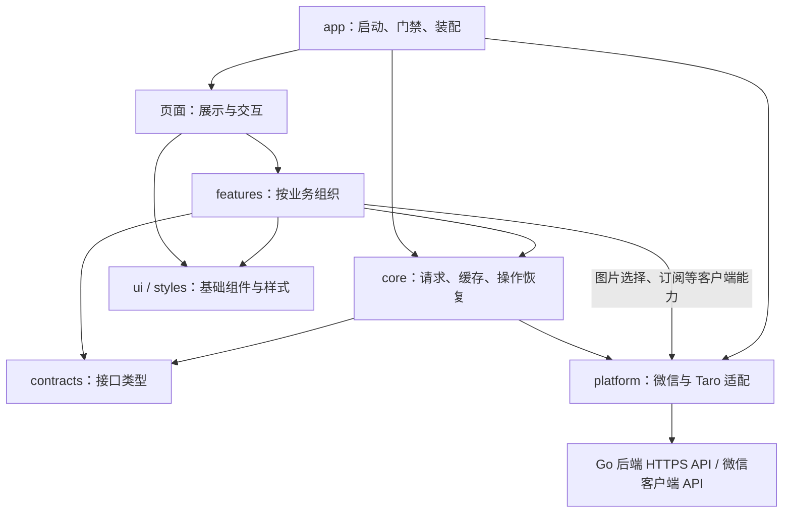
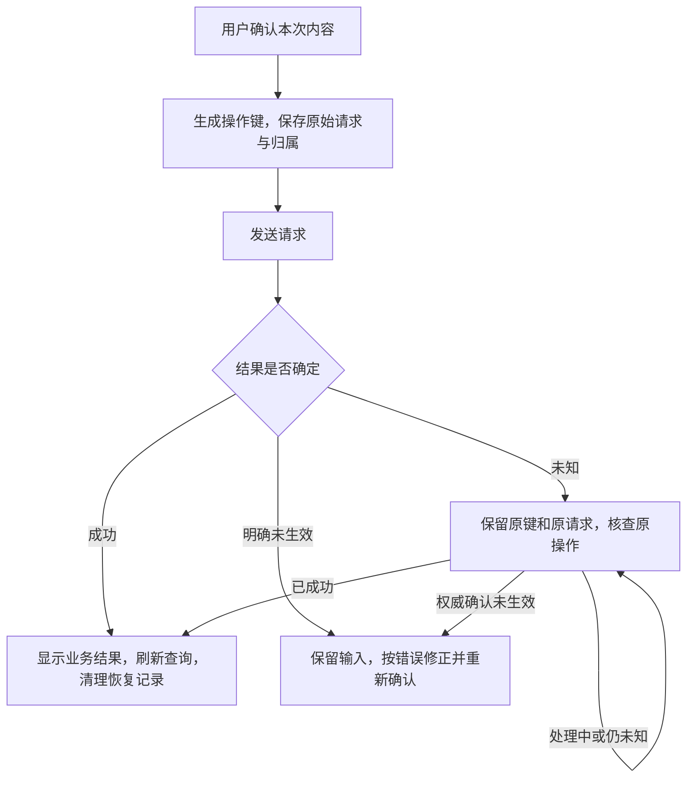

# 前端架构方案

状态：2026-10-21 架构建议稿。用户本轮选择先整理架构文档；仓库尚无前端业务工程，本稿不表示技术栈已最终确认或已通过小程序运行验证。

后续实施：用户已要求开始开发，首轮实际交付、验证及未完成范围见 [实施记录](implementation.md)；下文保留架构制定时的方案语境。

2026-10-21 整体复核：补齐组件复用与依赖方向、历史回执与当前状态的区分、未知操作终结、路由门禁、页面所需查询和受控图片读取；同步 [PRD 第 8.6–8.7 节](PRD.md#86-共享基础能力及归属) 的协作契约。

业务规则以 [PRD](PRD.md) 和 [领域词汇表](../CONTEXT.md) 为准，页面行为以 [UI 交互说明 v2](ui/interaction-spec-v2.md) 为准，视觉与图片沿用 [DESIGN.md](../DESIGN.md) 和 [素材包](../assets/ui/v1/README.md)。本文明确代码职责、数据流和实现顺序，不重新定义业务规则。

## 1. 总体方案

建议采用 **Taro + React + TypeScript，按业务组织模块，统一管理服务端查询，小程序能力集中适配**。前端放在仓库的 `frontend/`，与后端分目录、分别构建；第一交付目标是微信小程序体验版。

前端承担三件事：展示服务端事实，组织用户操作，在刷新、断网和返回页面时保持正确反馈。积分结算、库存扣回、业务授权、任务到期和订单自动确认始终由后端负责。

| 层次 | 主要职责 | 边界 |
| --- | --- | --- |
| 应用装配 `app` | 会话恢复、启动门禁、全局 Provider、生命周期接线、受控导航 | 只组织应用启动与运行，不计算积分或推导订单结算 |
| 页面 `pages` / `packages` | 路由参数、布局、表单、筛选、弹层、返回位置 | 调用业务模块，不在页面拼 HTTP 请求或各自实现鉴权 |
| 业务 `features` | 查询、写操作流程、状态展示映射、业务组件 | 每个模块维护自己的接口与展示规则；跨模块刷新明确列出 |
| 公共能力 `core` / `contracts` | 请求与错误归一、查询缓存、操作结果恢复、API 类型 | 不依赖具体业务页面，不建立第二套服务端业务状态机 |
| 平台 `platform` | 微信登录、网络、存储、图片选择上传、订阅授权、路由 API | 封装实际使用的平台差异，不建设通用多端框架 |
| 界面基础 `ui` / `styles` | 按钮、表单项、加载与空态、设计变量 | 不请求业务接口，不直接读取全局余额 |



页面生命周期可以直接使用 Taro Hooks；网络、持久存储和授权等有副作用的能力通过适配入口使用。公共层需要会话失效处理时，由应用层注入回调，不反向导入页面。业务模块只公开需要复用的查询、操作与组件，不互相读取内部文件。

## 2. 技术选择与取舍

以下为推荐组合，创建工程时再固定相互兼容的具体版本和锁文件。

| 项目 | 建议 | 原因与约束 |
| --- | --- | --- |
| 小程序框架 | Taro，React + TypeScript 模板 | 延续已有技术方向；使用小程序组件与生命周期，不按普通 DOM 网页开发 |
| 服务端数据 | TanStack Query | 统一查询缓存、请求去重、加载状态与失效刷新，避免每个页面维护一份余额 |
| 客户端状态 | React `useState` / `useReducer`，少量 Context | 表单和弹层局部管理；Context 只承载会话控制、运行状态等确需共享的能力 |
| 路由 | Taro 页面路由与原生四项 TabBar | 维持首页、任务、购物、我的；不引入浏览器路由 |
| HTTP | 基于 `Taro.request` 的薄适配 | 统一会话、错误和请求标识；图片上传走对应上传能力 |
| UI 与样式 | `@tarojs/components` + 自有基础组件 + SCSS 设计变量 | 对齐已确认设计；先实现实际需要的按钮、字段、卡片和弹层 |
| 工程管理 | pnpm；Taro 官方模板配套构建链 | 前后端在同仓库即可，当前无需额外 monorepo 编排工具 |
| 验证 | TypeScript、Lint、针对关键逻辑的单元测试、微信开发者工具及真机 | 浏览器预览只辅助布局，不能代替微信能力验证 |

Taro 使用小程序页面路由规范，[官方路由说明](https://docs.taro.zone/en/docs/router)也明确其不同于浏览器 history 路由。保留原生 TabBar，自定义内容导航区按 UI 需要处理胶囊与安全区。

TanStack Query 的[官方非浏览器接入说明](https://tanstack.com/query/latest/docs/framework/react/react-native)提供了焦点与网络状态的接入机制，但这是可借鉴的适配方式，**不构成 Taro 兼容性已验证的结论**。工程第一步要验证 Query Provider、Taro 请求、前后台切换和分页；通过后再铺业务页面。首版不叠加 Redux/Zustand，不引入前端事件总线、离线业务队列或 WebSocket。

## 3. 目录与依赖

以下是目标布局，实施时按实际需要创建文件，不预先生成空模块。

```text
frontend/
  config/                      # Taro 构建与环境配置
  src/
    app.tsx                    # Provider 与应用生命周期
    app.config.ts              # 页面、分包、四项 TabBar
    app/                       # 启动流程、会话控制、门禁、导航目标解析
    pages/
      entry/                   # 启动、登录结果与失败重试
      home/                    # 首页 Tab
      tasks/                   # 任务 Tab
      shop/                    # 购物 Tab，含页内购物车弹层
      me/                      # 我的 Tab
    packages/                  # 普通分包的二级页面
      tasks/                   # 任务详情、创建与编辑
      commerce/                # 商品详情、下单确认、订单、小店管理
      account/                 # 绑定、规则、伴侣、积分、消息、个人资料
    features/
      identity/                # 本人、伴侣、邀请码与绑定
      rules/                   # 当前规则与固定内容的提议
      points/                  # 余额、额度、池子、流水与赠送
      checkin/                 # 签到及累计里程碑
      catalog/                 # 两家小店的不同视角、商品与购物车
      orders/                  # 下单、接单、兑现、收货与订单取消
      tasks/                   # 两类任务、完成确认、补正与取消申请
      notifications/           # 站内消息、逐模板偏好与订阅流程
      home/                    # 首页聚合查询和展示组合
    core/                      # API 客户端、QueryClient、查询键、操作恢复
    contracts/                 # HTTP DTO、业务错误码、导航目标类型
    platform/                  # 网络、存储、微信能力、原生导航适配
    ui/                        # 无业务请求的基础组件
    styles/                    # 颜色、字号、间距、安全区等样式
    assets/                    # 经导出优化、实际进入包内的资源
  tests/                       # 跨模块的关键流程测试与契约样例
```

一个业务模块初期用 `api.ts`、`queries.ts`、`mutations.ts` 和实际需要的组件即可；只有状态映射复杂时才增加 `presentation.ts` 等纯函数文件。单次使用的组件就近放置，不将所有文件强制拆成多层 class、service、repository。

查询配置和业务操作归所属模块；查询键统一定义在 `core/query-keys.ts` 这类无业务依赖的纯函数文件中。订单操作需要刷新积分或首页时，只引用这些查询键，不导入积分查询 hook 或首页组件。各模块的 mutation 明确列出失效范围，公共缓存代码只接收键；`core` 不反向导入 `features`，模块之间不形成“订单 → 首页 → 订单”的依赖环。只复用图片选择、存储等实际需要的平台能力，不给每个 API 再套一层通用执行器。

分包负责下载与页面组织，业务模块负责代码职责，两者不是一一对应关系。四个 Tab 与启动入口留在主包；二级页面使用普通分包，共用应用会话与查询缓存。主包不静态导入分包页面，不在一个总入口导出所有业务组件，分包之间通过路由跳转而非互相导入页面。Taro 的页面及分包配置参照[官方配置文档](https://github.com/NervJS/taro-docs/blob/master/docs/app-config.md)；实际公共代码位置和包体要检查构建产物，不能仅凭目录断言已按需加载。

## 4. 页面、路由与启动门禁

UI 的 29 个画面包含同一页面的不同状态，不对应 29 个独立页面。进行中、待确认和结算结果复用详情页；购物车保持购物页内弹层。

| 页面组 / 建议路由 | 对应设计 | 实现边界 |
| --- | --- | --- |
| `pages/entry/index` | 启动流程 | 恢复会话、读取上下文、处理登录失败及重试 |
| `pages/home/index`、`pages/tasks/index`、`pages/shop/index`、`pages/me/index` | H01 / T01 / S01、S03 / M01 | 四个 Tab，共用消息入口；S03 为购物页内弹层；列表筛选与滚动位置保留 |
| `packages/account/binding/index`、`rules/index`、`rule-detail/index` | B01 / B02 / R01 / R02 | 绑定页内切换邀请/输入；首次与后续规则共用模块，提议详情按具体 ID 打开 |
| `packages/tasks/edit/index`、`detail/index` | T02–T05 | 创建/接受前编辑共用表单，详情承载主阶段、取消申请与结果 |
| `packages/commerce/product/index`、`checkout/index` | S02 / S04 | 参数只携带商品标识；本次确认价格由读取结果形成 |
| `packages/commerce/orders/index`、`order-detail/index` | O01–O04 | 列表切换双方角色；详情展示当前状态和后果确认 |
| `packages/commerce/store/index`、`product-edit/index` | M02 / M03 | 管理本人小店，复用商品组件，不复用伴侣浏览权限 |
| `packages/account/partner/index`、`gift/index`、`gift-detail/index` | P01 / P02、赠送记录 | 赠送结果可从流水进入详情；关系只读 |
| `packages/account/pool/index`、`points/index`、`checkin/index` | I01 / I02 / H02 | 池子流水与预留、个人流水、累计里程碑 |
| `packages/account/messages/index`、`message-detail/index`、`notification-settings/index`、`notification-template/index` | N01–N03 | 消息详情保留全文；设置分组完整显示 30 个模板，单模板独立设置 |
| `packages/account/profile/index` | 本人资料入口 | 若实施本人资料编辑，限已有头像/昵称能力 |

表中后续简写路径沿用该行第一个目录前缀；最终注册路径在创建工程时统一固定。路由参数不携带可信余额、角色、规则生效状态或完整业务对象。

启动门禁使用明确状态：读取中、需登录、需绑定、首次规则待生效、可用、读取失败。由启动上下文返回本人、关系、规则状态和服务端时间；规则上限为 0 仍可进入可用状态。

1. 恢复自有会话；需要登录时，通过微信登录凭证交给后端换取自有会话。前端不保存微信服务端密钥。
2. 读取启动上下文；未绑定进入绑定流程，已绑定但首次规则未生效进入规则流程。失败展示重试，不以空数据当成“未绑定”。
3. 规则已生效后进入目标页面；后续修改提议不会关闭业务。绑定、首次规则确认成功后重新读取上下文，不由前端创建积分池或空店。
4. 所有页面，包括从微信消息直达的详情，按下表所需阶段通过同一门禁。所需门禁通过前不发该页业务查询，避免把完成门禁所需的规则接口本身阻断。不能假设用户一定经过入口页。
5. 暂存经过校验的导航目标，如 `{ type: order, id }`；登录与门禁结束后重新取对象并鉴权。过期、无权限或未知目标显示可返回入口，不从消息恢复旧按钮。

`app` 维护受控的业务目标到路由映射，消息、待办、积分流水共用它。普通详情用 `navigateTo`，返回用页面栈；没有上级页面时回所属 Tab。切换 Tab 使用 `switchTab`，它不能在 URL 后附加参数，见[官方 API](https://github.com/nervjs/taro-docs/blob/master/i18n/en/docusaurus-plugin-content-docs/current/apis/route/switchTab.md)。需要定位列表时用一次性、可校验的导航意图，不把整个业务对象塞进全局状态。

| 入口 / 查询 | 最低阶段与处理 |
| --- | --- |
| 登录、恢复会话 | 无需已有会话；失败留在入口重试 |
| 本人启动上下文、邀请码与绑定 | 已登录；已经绑定时不能再次绑定 |
| 共同规则列表、具体提议、规则页所需双方资料/头像 | 已登录且已绑定；首次规则未生效时也可查询、提出和确认 |
| 首次 R02 对应站内消息标读 | 已登录且已绑定；成功打开该提议后，只标记属于本人的对应规则消息，不开放整个消息列表；没有站内记录时不创建记录 |
| 原操作结果查询与关闭 | 已登录，并校验原操作归属；不额外要求首次规则生效，以免绑定/首次确认的未知结果无法恢复 |
| 四 Tab 及任务、购物、订单、积分、伴侣设置、消息和通知设置 | 已登录、已绑定且首次规则生效；不满足时保留目标，先完成门禁 |

沿用 UI 的首次规则流程：R02 始终保留具体提议 ID，可在首次阶段直达该份提议；R01 的伴侣设置目标在首次规则生效后恢复，期间先展示规则流程，不误开赠送或购物。被重定向的消息不能仅因跳转开始就标为已读；真正展示消息正文或成功打开其业务目标后，再按统一策略标记。后端对这些入口采用相同阶段区分，同时继续执行对象授权。

## 5. 业务模块职责

| 模块 | 前端负责 | 依赖的服务端事实 |
| --- | --- | --- |
| `identity` | 登录交互、本人资料、邀请与绑定、伴侣只读展示 | 可信身份、关系及邀请码结果 |
| `rules` | 提议表单、逐份确认、已作废提示、首次门禁展示 | 当前有效规则、提议状态与确认权限 |
| `points` | 分开展示余额/额度/池子，赠送预览与实际结果，流水跳转 | 实际余额、当日已得、剩余额度、预留、赠送次数与结算记录 |
| `checkin` | 本人签到动作、双人状态、累计里程碑展示 | 当天签到状态、本次入池组成和已达成档位 |
| `catalog` | 伴侣店浏览、本人店编辑、封面上传、候选购物车 | 商品当前价格/库存、店铺归属、持久媒体标识 |
| `orders` | 单商品确认、结果恢复、按角色显示接单/兑现/取消/收货操作 | 商品快照、实扣积分、最新阶段、取消申请及本轮自动确认时间 |
| `tasks` | 两类表单、主阶段和取消申请并列展示、补正截止、结果说明 | 当前约定、有效 deadline、操作权限、结算及操作历史 |
| `notifications` | 消息全文与未读、30 个模板偏好、微信授权交互 | 站内历史、偏好、平台模板能力及授权记录 |
| `home` | 聚合查询和页面组合，复用签到与积分展示组件 | 后端聚合的签到、积分、待办；待办不从消息列表推算 |

模块按业务边界保持一致，前端不照搬后端的事务、调度和事件总线。首页由一个聚合查询提供相关事实，不要求客户端串行调用八个模块后自行拼出一致的余额与待办。

可复用的业务展示组件接收数据与操作回调，内部不自行查询。例如首页把聚合结果交给签到台和积分摘要，再接入 `checkin` 的操作 hook；这些组件不能再分别获取一份签到与余额。独立详情页则由自己的查询容器提供数据。需要请求的组合组件明确标为容器，不能隐藏在通用卡片里。可复用组件清单见第 10.1 节。

## 6. 状态归属与刷新

### 6.1 哪些数据放在哪里

| 数据 | 归属 | 持久化原则 |
| --- | --- | --- |
| 身份上下文、规则、商品、任务、订单、积分、消息 | TanStack Query 查询缓存 | 服务端为唯一事实来源；首版不把整个业务缓存持久化为可离线操作的数据 |
| 表单、弹层、单选商品、列表筛选、滚动位置 | 页面或对应业务组件 | 默认页面内存；提交失败保留输入，重进详情重新读取业务事实 |
| 会话凭据、应用可见性、一次性导航意图 | 应用控制层 | 会话凭据按实际过期机制存储；不重复存一份可独立修改的用户与余额对象 |
| 购物车候选 | 建议由后端 `catalog` 按用户保存，前端查询缓存展示 | 与现有后端模块归属对齐；价格、库存、余额不随候选持久化为可信快照 |
| 尚未查清结果的写操作 | `core` 的最小操作恢复记录 | 按用户、关系隔离保存原操作键及必要请求；查明结果后清理 |

购物车持久化是本稿的实施建议，原 UI 尚未固定具体方式。候选增删由服务端确认后更新；失效商品保留移除入口。下单成功后移除该候选可作为独立清理动作，清理失败不否定订单成功、不触发重新下单，其余候选保留。

查询键统一包含会话范围和查询参数，例如 `['scope', userId, relationshipId, 'tasks', 'list', filters]`；列表的角色、类型和筛选必须进入键。普通分页将页码纳入键；连续加载列表在同一筛选键下维护分页参数，不为每个游标另建一套列表。一个查询只由所属模块定义，其他页面复用；不同查询可有快照，但不能再复制到另一套全局 store 中独立修改。

会话过期或账号变化时，停止旧查询、清除旧业务缓存，并让旧请求响应失效。原账号的未知操作记录隔离保留，重新验证同一身份后才能恢复；不能为了清缓存把尚未查清的订单操作键丢掉，也不能由另一个账号重放。

### 6.2 小程序生命周期

Taro 区分页面显示、隐藏和组件卸载，[官方 React 页面示例](https://github.com/NervJS/taro-docs/blob/master/i18n/en/docusaurus-plugin-content-docs/current/react-page.mdx)提供 `useDidShow` / `useDidHide`。Tab 或详情被遮住时可能仍在内存里，仅用 React 卸载清理轮询不够。

- 应用显示/隐藏接到 Query 的焦点管理，网络变化接到在线状态管理；页面另外维护是否可见，两个条件同时满足才执行可见页查询和轮询。读取初始网络状态并注册监听，应用装配只注册一次。
- 首次进入、页面重新显示、下拉刷新和网络恢复时读取该页所需数据。购物页、商品详情、打开购物车及进入确认页，必须刷新价格、库存与个人余额；可见时每 30 秒刷新，隐藏或应用切后台时停止。
- 首页、任务/订单列表与详情、消息列表等需要看见对方操作的页面，首版也建议可见时每 30 秒刷新；邀请等待与规则等待页同样刷新启动上下文，避免另一方完成绑定或确认后停留在旧门禁。无关隐藏页面只标记失效，显示时再读。
- 同一查询键的请求合并；首页聚合与详情按各自查询返回，不将部分聚合结果写成完整详情。轮询不重置筛选、表单、购物车选中项和滚动位置。
- 消息、订单、任务和流水采用服务端稳定排序及分页边界，刷新与追加结果按记录 ID 去重；切换筛选清理旧分页，不能混入旧筛选的迟到响应。返回列表保留筛选、已加载范围及可见记录锚点；刷新后原记录消失时取相邻记录，不恢复已经失效的操作。
- 按服务端返回的北京时间日期识别跨日，刷新签到、额度和赠送次数。前台跨零点可安排一次读取，回前台也重读；不在客户端直接清零或发奖。
- 详情到达显示的 deadline 或自动确认时刻时触发重新读取。手机时钟和倒计时仅提供展示提示，不自行将任务改为超时、扣分或把订单改为完成。

首次加载、空列表、读取失败、正在刷新、离线有旧数据分别展示。断网时可保留当前已读内容并标明未更新，禁用需要提交的动作；旧余额不是可下单承诺。

### 6.3 写操作后的数据更新

业务写成功，先展示已确认的结果，再刷新相关查询。刷新失败只说明“结果已保存，数据更新失败”，不能把成功操作改报失败。积分、库存与业务阶段不做提前宣告成功的乐观更新。

操作回执和当前对象是两种数据。尤其是幂等恢复返回的“下单时余额、当时待接单”等只证明原操作结果；订单可能已经取消或完成。首版将回执用于本次结果说明，当前详情、余额和可用操作重新查询，不用旧回执覆盖查询缓存。当前读取失败时保留已确认的操作结果并提供刷新，不能恢复历史按钮或再次提交。

| 操作 | 需要失效或更新的查询 |
| --- | --- |
| 绑定 / 首次规则确认 | 启动上下文、规则、首页、积分及小店；进入新关系范围时清理旧缓存 |
| 创建规则提议 | 规则列表及对应提议、首页待办；首次阶段刷新规则等待页，不重置已有生效规则 |
| 购物车增删 | 本人候选列表/数量；移除选中项时清空局部选择，不改动积分或库存 |
| 本人资料保存 | 启动上下文、首页、我的及关系资料展示；不重写历史通知正文 |
| 签到 | 首页、签到记录、里程碑、积分池与池子流水 |
| 商品保存 / 库存修改 | 所属店铺列表、商品详情、购物车商品信息、正在确认的商品 |
| 下单、拒单、有效取消 | 订单详情/列表、商品/购物车、个人积分、池子及相关流水、首页待办 |
| 接单、提交兑现、收货、驳回、取消申请处理 | 订单详情/列表、首页待办；发生退分或扣罚时同时刷新积分与库存 |
| 任务发布、编辑、接受、提交、确认、补正、取消或到期结果 | 任务详情/列表、首页、积分池与预留；涉及结算时同时刷新个人积分与流水 |
| 赠送 | 赠送额度/次数、相关个人积分、赠送记录、首页 |
| 共同规则生效 | 启动上下文、全部相关规则提议、首页、每日额度及赠送预览；保留当日真实累计 |
| 消息已读 / 偏好修改 | 消息列表、未读数，或对应模板偏好与授权状态 |

查询键和刷新范围使用显式函数/列表，不广播字符串事件让各页自行猜测。更新前取消或作废可能覆盖新结果的旧读取；响应返回晚于写操作时也不能回填旧状态。跨账号请求另用会话代次隔离。对方设备的变更通过可见页刷新收敛，最后的合法性仍由后端校验。

写请求被拒绝也可能需要跨模块刷新：后端在下单前独立补齐到期任务结算，即使下单失败，罚分和退池已经生效。收到到期、余额不足或相关状态冲突时，重新读取积分、任务和首页等受影响数据，不能因为原操作失败就恢复旧余额。

消息允许晚于业务成功产生：业务成功立即刷新业务数据，消息入口下次显示或轮询时再读取。首页待办不依赖站内消息是否已生成或是否开启通知。

## 7. 请求、错误与幂等恢复

### 7.1 统一请求入口

请求入口负责 API 地址、自有会话、HTTP 与业务错误、请求标识、超时及响应解析。各模块负责路径、DTO 和操作含义；不让页面到处捕获原始微信网络错误。

| 结果类别 | 前端处理 |
| --- | --- |
| 参数错误 | 关联字段，保留输入；数值为空不视为 0 |
| 会话失效 | 暂停业务查询，合并并发登录恢复，失败后展示重试；不循环重登 |
| 无权限 / 对象不存在 | 停止显示可操作状态，允许回上一级；不使用缓存对象继续操作 |
| 规则门禁 | 刷新启动上下文，进入对应流程 |
| 状态已变化 / 提议已作废 / 已到期 | 重新读取当前详情与可用动作，保留历史，不恢复旧状态 |
| 价格变化 / 库存不足 / 积分或预算不足 | 更新相关数据与确认内容，保留表单，按具体原因处理 |
| 读取网络故障 | 保留已读内容与重试入口；只对适合重试的读取做有限重试 |
| 写请求超时、断网或响应无法确认 | 进入原操作结果核查；不能一律宣称“提交失败，请再试一次” |

建议读取请求仅对暂时网络故障最多自动重试一次，业务错误不重试。写操作显式关闭自动重试和离线排队，是否重试由操作恢复流程决定。采用 Query 时，写操作可配置 `networkMode: 'always'` 配合提交前网络检查和 `retry: false`，使断网尝试立即归类，而不是联网后静默执行；不持久化/恢复 Query 的暂停 mutation 队列。这个取舍依据其[网络模式说明](https://tanstack.com/query/latest/docs/framework/react/guides/network-mode)，具体行为必须通过断网用例验证。

### 7.2 写操作的生命周期

按钮禁用只避免当前页面连点。下单、赠送、任务发布/结算、规则确认等写操作均需要后端幂等支持。



- 发送前持久保存操作键、用户/关系、动作、必要请求数据和创建时间，防止响应返回前小程序被关闭。保存失败时不发送这类操作，避免形成无法恢复的重复风险。
- 同一意图只对应一份待确认记录；发送中或结果未知时，同一业务对象/动作的各入口共享恢复记录，不因换入口生成新键。恢复只核查已经确认过的操作，不自动提交表单草稿。
- 恢复优先查询后端操作结果；原键重试必须保留**原键、原参数**，不把重试当作纯读取。重启、跨日或原页面已经离开后，不自动重新执行可能尚未到达服务端的旧写请求，先查询或终结原操作，再让用户决定下一次提交。后台不继续轮询；同一身份回前台后恢复，网络故障时有限退避并提供手动核查。
- 超时、5xx、取消客户端网络任务、普通“查不到订单”都不能证明未创建。查询尚无记录也不能排除原请求仍在处理中；结果不明时不得换键创建替代订单。
- 只有原操作已经成功或被权威判定未生效，才能结束未知状态。用户修改价格/奖励等参数形成新意图前，先解决原操作；新确认才使用新键。
- 后端沿用“操作人 + 操作类型 + 幂等键”的识别方式，校验同键内容一致。只读核查返回成功回执、明确未生效终态、处理中或暂无记录；后两者都不能解锁新提交。
- 为使未知结果可以结束，后端提供关闭原操作的入口，与原键执行在同一仲裁边界内原子确定：原请求先成功则返回原回执；关闭先成功则保存“未执行且已关闭”，迟到原请求和同键重放都不能再执行业务。处理中则继续核查，不能通过查列表推测已关闭。这是请求幂等能力，不另建后台业务队列。
- 首版建议成功回执、确定拒绝及关闭标记按业务历史保留，不自动按 TTL 删除。以后如需清理，必须先定义旧键拒绝与结果核查协议；客户端清理恢复记录不删除服务端幂等依据。

恢复记录是少量尚未结案操作的记录，不是离线任务队列。已经成功的业务历史仍从后端查询。操作键、请求指纹等实现细节不出现在产品文案中。

## 8. 关键交互的架构约束

### 8.1 下单与改价

下单确认分别保存“当前读取的商品”和“用户本次明确确认的价格”，不能用自动刷新的新价覆盖已经确认的旧价。请求携带商品 ID、本次确认价格及操作键，数量按单商品一份约束处理。

1. 进入购物、商品、购物车和确认页按第 6 节刷新；前端展示商品可用性、库存及余额，负余额连 0 积分商品也禁用。
2. 当前价格变化时取消原确认，显示旧价与新价，按钮、摘要和明细使用一致的新值，由用户再次明确确认；服务端拒绝旧价时采用同一交互。
3. 已有未知下单结果时，价格刷新只更新浏览信息，不能开启另一笔替代下单。先查清原操作，再决定进入订单或重新确认。
4. 成功后进入返回的订单 ID，展示本次实扣积分，再读取订单当前状态；恢复旧请求时不假定仍待接单。订单展示保存的商品快照，不能重新拿当前商品价格或封面替换历史约定。

### 8.2 任务与订单分别组织操作

任务详情至少分开保存主阶段、取消申请、有效截止、当前用户可用操作。取消申请是独立区域：申请期间仍可按权限提交、确认、补正；拒绝取消只使用服务端最新详情，不恢复申请时保存的阶段或 deadline。

订单取消待处理则限制后续兑现/收货流程，不能直接复用任务取消逻辑。订单组件使用本轮有效自动确认时间，驳回或申请取消后不继续展示失效倒计时。店主主动取消按订单实扣积分计算后果预览，最终扣罚取服务端结果。

建议详情响应提供 `allowedActions` 和必要的不可操作原因；前端集中映射文案与按钮，并叠加加载、输入和网络条件。服务端仍逐次验证权限与状态，返回的动作列表也是可过期的快照。无需为这些固定流程引入通用状态机引擎。

任务/商品编辑时，表单草稿与查询结果分开：初始化后刷新不能重填已修改字段；任务已被接受、结束或到期时，保留输入供查看并停止提交，重新读取当前约定。按 PRD 第 5.1、8.3 节，任务不增加版本核对或再次确认流程；响应的时间/版本若用于缓存新旧判断，也不能变成新的任务接受门槛。

### 8.3 积分、表单与时间

表单保存原始文本，区分空、0、负数和非法数值。积分先检查非负，再按约定四舍五入并展示取整结果；库存只接受非负整数。输入规范化与格式化使用可测试的纯函数，避免依赖浮点误差或先取整把负数放行。字段长度、数值上界、图片限制由 API 契约提供，不从图稿推导。

预计到账与实际到账用不同的数据来源：前者可按最新服务端余额/额度做预览，后者只读写操作结果。共同任务可出现双方到账不同；0 分赠送仍计次，任务超额释放与赠送超额消失分别说明；余额负值保留负号。

编辑待接受任务的奖励时，预算预览使用“新总预留 − 原预留”的差额；只将需要追加的部分与池子可用余额比较，不能要求已经预留的积分再预留一次。降低奖励展示释放差额，保存仍由后端在事务中校验和处理。

所有绝对时间以有明确时区的格式传输，客户端统一显示北京时间；分钟选择转换成对应北京时间的 `HH:mm:00`，不按设备时区隐式解析。服务端时间用于展示校准，截止是否有效仍以服务端判断为准，不能依靠客户端“提前点击”承诺提交成功。

### 8.4 微信消息订阅

30 个内部业务模板使用稳定编号，设置逐模板保存，默认仅站内；分组只是列表组织。内部编号和实际微信模板 ID 分开，映射与可用性由后端提供，不假定 30 个业务模板都能直接映射成功。

保存偏好、请求微信授权、上报授权结果是三个可分别成功/失败的步骤。授权请求在用户明确点击时触发，所需模板映射提前加载；不在启动或定时刷新时自动弹窗。用户点击等触发约束见 [Taro 订阅 API 文档](https://github.com/NervJS/taro-docs/blob/master/docs/apis/open-api/subscribe-message/requestSubscribeMessage.md)。请求数量等限制按选定基础库及实际账号验证后处理。

页面分别表达偏好已保存、授权已接受/拒绝/不可用、结果待同步；不能把保存微信偏好解释成已获永久授权或投递成功。授权失败不撤销业务，也不擅自改投站内。微信实际发送、模板渲染与投递结果由后端处理。

## 9. 前后端需要对齐的契约

下表是接口需求，字段名为建议，不代表仓库已有这些接口。路径、DTO、分页和错误码应在开始对应模块前共同固定；可用 OpenAPI 统一定义并生成 TypeScript 类型，避免分别手写长期漂移。

| 契约 | 最少需要的语义 |
| --- | --- |
| 登录与启动上下文 | 自有会话及过期语义、本人/伴侣、关系、首次规则是否生效、服务端时间和业务日期 |
| 首页聚合 | 同次读取的签到、个人余额/今日额度、池子总额/可用/预留、本人待办、累计里程碑；独立于通知开关 |
| 列表与详情 | 稳定 ID、明确枚举、稳定排序/分页边界、当前阶段/角色、可用操作、更新时间；任务取消申请单列，并返回当前有效 deadline；订单返回本轮有效自动确认时间及历史 |
| UI 筛选 | 任务“待接受”单独显示双方等待接受的事项；“进行中”显示已接受但未结束的事项（含待确认完成）；“待我处理”按当前角色及可用操作生成，不显示数量角标以免与状态分类重复。客户端分页读取现有 `filter=active` 的全部未结束事项，共享列表及计数，历史保留分页；订单按我下的单/我收到的和状态筛选；入口与列表显示各未结束状态数量，角色显示相应未结束合计，底部“我的”仅统计服务端 `Home.orderTodos` 中需要当前用户操作的订单，“全部”不加角标，取消申请按原状态仅计一次；历史包含全部结束原因 |
| 操作预览 | 赠送页取得接收方当日剩余额度、单次上限和本人剩余次数；共同任务确认取得双方额度及预计到账；编辑任务取得原预留与当前可用预算；订单取消取得实扣积分及操作者余额。预览不占额度/库存、不冻结规则，最终以提交结果为准 |
| 写入结果 | 业务对象 ID、本次确定的积分后果及发生时间、请求标识；作为操作回执，当前详情另读；无需等待通知生成 |
| 业务错误 | 未登录、门禁、无权限、状态冲突、改价、库存/积分/预算不足、提议失效、到期等可区分；按需提供最新值 |
| 幂等与结果核查 | 同键同参数、原成功回执、处理中/暂无记录/确定拒绝/已关闭的区分；关闭与执行原子仲裁，关闭后拒绝迟到原请求；终态保留，无记录不等于未执行 |
| 购物车 | 候选持久化归属、增删语义、商品失效项；加入不占积分和库存，结算固定一件一份 |
| 消息与深链 | 固定历史正文/发生时间、未读状态、受控业务目标类型和 ID；详情另读当前状态 |
| 偏好与微信模板 | 30 个内部编号、四种渠道、有效默认值、平台映射与能力、授权结果上报；历史不补发 |
| 图片 | 上传约束、持久 `fileId`、受控读取的鉴权方式/状态码、归属和引用保护；小程序请求、上传、下载域名分别验证 |
| 通用值类型 | ID 用字符串；积分整数、库存非负整数，数值范围与安全解析明确；时间含时区，日统计日期采用北京时间 |

TypeScript 类型不能替代运行时参数校验和服务端授权。前端只展示允许的操作，后端依然校验对象归属、门禁、状态、库存和余额；遇到未知枚举或不兼容响应时保留安全的只读/错误反馈，不默认放行。

这些查询是后端已有模块的只读接口或应用聚合，不新建前端专用服务。预览涉及余额、额度或任务状态时，后端也先补齐到期结算，按同一次读取返回必要事实及服务端时间；前端不根据首页的本人额度推测伴侣额度。消息“全部已读”应针对明确的通知 ID 集合或服务端返回的接收顺序边界，避免异步晚到、业务发生时间更早的消息被误标为已经读过。

## 10. 组件、素材与工程边界

### 10.1 组件复用

基础组件只负责呈现；业务展示组件只解释已传入的领域数据；页面容器和业务 hook 负责查询、操作与失效刷新。组件名称为实施指引，按真实复用需求提取，不一次性创建整套组件库。

| 组件 / 归属 | 复用位置 | 输入与边界 |
| --- | --- | --- |
| `PageLayout`、`ActionBar` / `ui` | 四 Tab 与二级页的内容区域、表单底部 | 接收标题、工具位、内容和操作；集中安全区/键盘避让，不内置登录判断或业务按钮 |
| `Button`、`FormField`、`ConfirmSheet` / `ui` | 表单、取消后果确认、购物车外壳 | 接收加载/禁用/错误及回调；按钮不自己发请求，关闭弹层不等于取消已发出的业务 |
| `LoadState`、`EmptyState`、`StatusTag` / `ui` | 列表、详情、空店和空任务 | 区分首次读取、刷新、离线和失败；由调用方提供文案及操作，不自行决定谁能建商品 |
| `PointsText`、`NumberField`、`BeijingDateTimeField` / `ui` | 各积分显示，任务/赠送/规则/商品表单，任务创建及补正 | 输入保留原始文本，格式化与非负取整共用纯函数；上限、截止是否合法由业务层判断，库存不能复用积分的小数取整规则 |
| `BalanceSummary`、`PoolSummary` / `features/points` | 首页、我的、积分详情 | 分别接收余额/当日额度和池子总额/可用/预留；不根据某个数是否为 0 判断规则状态，不内置查询 |
| `CheckinPanel`、`MilestoneSummary` / `features/checkin` | 首页及签到记录 | 接收签到/累计结果与本人操作回调；不本地发奖，也不另查一份首页数据 |
| `ProductSummary` / `features/catalog` | 购物、购物车、下单确认、本人店铺列表 | 接收只读商品展示值，购买/编辑动作由外层提供；订单可复用外观，但由 `orders` 从订单快照映射，不能只传商品 ID 再读现价 |
| `TaskSummary`、`OrderSummary` / 各自模块 | 各列表和对应详情摘要；首页按聚合数据需要组合 | 共享标签、时间、积分基础件，分别维护角色和阶段文案；任务取消条和订单取消限制各自实现，不合成通用流程卡 |
| `ResultPanel` / `ui`，结算内容 / 各业务模块 | 下单、任务结算、退款扣罚、赠送结果 | 外壳只接收内容；任务释放退池、赠送超额消失、订单退款扣罚分别由所属模块解释，预计值与实际值不能混用 |
| `CoverField` / `features/catalog`，媒体读取 hook / `core` | 商品创建/编辑；头像与封面复用读取能力 | 表单持有选择/上传进度和 `fileId`；实际图片组件接收解析后的可显示地址，单张必选、快照引用等规则仍属业务模块 |
| 消息入口、未读标记 / `features/notifications` | 各主页面工具位、消息中心 | 展示件接收未读数及打开回调；容器共用一份未读查询，不能拿未读数替代首页待办数 |

颜色、字号、间距与圆角集中引用 UI v2 设计变量。长文案、字段错误、读屏名称、触控面积和弹层关闭/焦点行为在基础组件统一验证；同一组件在窄屏和大字下允许纵向排列。复用不改变页面的权限、数据来源和业务后果，不引入配置式表单或通用详情引擎。

按 UI 的 390px 逻辑宽度明确配置 Taro 尺寸换算；安全区、滚动区、键盘避让和胶囊留白集中处理。适配 320–430px 和大字体时允许信息纵向排列，不能靠固定截图比例锁死布局。

素材原图约 19.75 MiB，只作为源文件保存。`frontend/src/assets` 按实际显示尺寸与使用位置收录优化后的必要资源，其他装饰或可选封面按需加载；发布前检查主包与分包实际大小。图标保留统一矢量来源，原生 TabBar 使用平台支持的导出图标格式，不直接假定 SVG 可用于所有小程序位置。

### 10.2 图片上传与受控读取

商品封面流程为选择单张图片 → 本地预览 → 上传并取得持久文件标识 → 保存商品引用。上传完成前不能保存商品；失败保留其他字段。历史订单引用原文件，新封面使用新标识；签名读取地址只作临时展示，不能保存为订单快照。系统封面若启用，也走后端可授权的持久文件引用，不把本地打包路径当作服务端文件 ID。四张示例封面不自动创建商品。

原生图片显示不会自动经过 JSON 请求入口的鉴权。首版建议 `core` 的媒体读取 hook 通过 `platform` 使用带自有会话头的 `Taro.downloadFile` 读取受控接口，检查 HTTP 状态后将临时路径交给图片组件；参考 [Taro 下载 API](https://github.com/NervJS/taro-docs/blob/master/i18n/en/docusaurus-plugin-content-docs/current/apis/network/download/downloadFile.md)。后端按当前用户与文件归属授权，包括首次规则页需要的双方头像；图片加载失败不等于文件被删除。

下载按账号与 `fileId` 去重。微信小程序将已鉴权下载的图片持久保存到本地，以 API 地址和用户 ID 隔离，最多 32 张且总量不超过 32 MiB，超限淘汰最久未读取的图片；重新进入直接显示缓存，文件丢失时重新下载。退出登录、会话失效或切换账号清理本地文件，晚到的下载和文件保存结果不能恢复旧账号缓存；保存失败时继续显示临时文件。H5 保留最多 32 张的运行期内存缓存。上传和下载同样处理会话失效、网络错误及 HTTP 失败，不能把平台成功回调直接视为业务成功。服务端私有图片仍经本人或伴侣鉴权并返回 `Cache-Control: no-store`，Nginx 不开启共享图片缓存。若以后改为短期签名地址，应替换统一媒体读取适配并处理到期刷新，业务组件仍只保存 `fileId`。图片不因显示缓存而获得新的服务端权限。

### 10.3 工程与发布

开发/体验/生产配置明确 API 域名与小程序配置；前端只有可公开配置，不包含后端、数据库或微信服务端密钥。发布包不加载开发模拟数据。日志仅记录必要的请求标识、业务错误码、页面与操作阶段，不输出会话凭据、邀请码或完整私人内容。

## 11. 实施顺序与验收

| 阶段 | 交付 | 验证标准 |
| --- | --- | --- |
| 1. 工程与契约最小闭环 | 创建 Taro 工程、四 Tab/启动入口、网络与查询适配、登录/启动契约、原操作查询/关闭 | 开发者工具及真机可运行；身份门禁、无网络、前后台与分包直达可验证；未知操作可终结且迟到原请求不生效；固定兼容版本 |
| 2. 绑定、规则、首页 | 一次性绑定、首次规则、签到、积分和待办聚合 | 上限 0 正常开放；不重复初始化；跨日显示正确，待办独立于通知 |
| 3. 小店到订单 | 封面上传、商品管理、购物车、单件下单、接单/兑现/收货/取消 | 改价重新确认、负余额/缺货阻止下单；断网和重启后查清同一订单；历史快照稳定 |
| 4. 任务与赠送 | 两类任务、预留、提交/补正/取消、实际结算与赠送 | 任务取消不回滚主阶段，订单取消限制不同；0 分、超额、负余额及截止边界正确 |
| 5. 消息与设置整合 | 消息中心、未读、30 个偏好、微信授权与真实跳转 | 业务模块开发时已有对应 API，整合后核对完整通知清单；拒绝授权不影响业务或偷偷改渠道 |
| 6. 发布检查 | 真机交互、包体、环境配置与体验版 | UI v2 的窄屏/大字/键盘与安全区通过；真实后端、上传、订阅及双端操作验证 |

测试集中在会产生错误业务反馈的地方：

- 纯函数：空与零、负数和取整、库存整数、北京时间转换、任务与订单操作展示差异。
- 请求/缓存集成：同键恢复、未知结果重启恢复、同键参数变化拒绝、会话过期与账号隔离、旧响应/历史回执不覆盖当前结果、写成功但刷新失败；原请求与关闭竞争时只返回成功或不可再执行的关闭终态。
- 组件与契约：首页聚合不被子组件重复查询；实时商品和订单快照使用同一外观仍展示各自数据；双方预计额度、任务列表筛选和异步晚到消息的已读边界正确；R02 首次提议直达保留 ID，R01 完成规则后恢复伴侣设置目标。
- 生命周期：Tab 切换和进入详情后隐藏页停止刷新、回前台恢复、断网不排队提交、跨北京时间零点重读。
- 业务场景：改价 21 → 30 重新确认；负余额不能下 0 分订单；下单被拒绝仍刷新已发生的超时罚分；任务取消期间及时提交后拒绝取消仍待确认；上限 0 正常开放；赠送 0 仍计次；旧规则通知不能再次确认已作废提议。
- 真机链路：登录与绑定、图片上传/受控下载及临时路径失效、消息深链、真实订阅授权，以及一人操作后另一人刷新看到新状态。完整后端一致性场景仍见 [PRD 第 8.8 节](PRD.md#88-实施验证边界)。

本轮完成架构文档复核及前后端/UI 契约对齐，尚未运行上述工程、接口或真机测试。进入实现前需固定库版本、API 字段/错误码/原操作关闭接口、购物车持久化约定和平台接入配置，并验证幂等与媒体读取方案；这些是实现准备，不再开启已经确认过的业务需求访谈。
