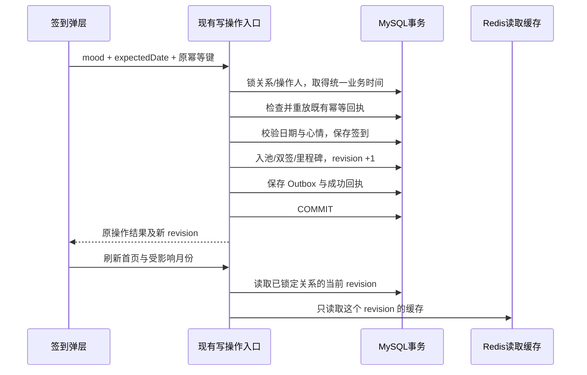

# 心情签到与双人日历：前后端实施方案

状态：2026-10-23，前后端与运行素材已按本方案实现，正在完成验收与发布。真实 MySQL/Redis 集成、浏览器流程及缓存故障场景已有验证；原生微信与最终发布以[验收记录](ui/mood-checkin-acceptance.md)的实际证据为准。16 张心情原图及生产导出见[素材说明](../assets/ui/moods/v1/README.md)与[亮暗预览](../assets/ui/moods/v1/preview.html)。

## 1. 本轮范围与默认规则

- 首页保留当前布纹底板、两角花草、紫蓝头像绣边与爱心绣线。未签到显示本人头像；签到了且有心情时，在同一圆框内换成心情图，双方独立变化。
- 签到按钮打开八选一弹层，选择后再确认。首页只增加“心情日历”文字入口，不再放周历。
- 新增双人月历：同一天上面是当前用户、下面是伴侣，始终显示昵称与顺序说明，不提供单人筛选。点日期看当天两人的心情与签到时间。
- 复用每天一次、北京时间自然日、每人 +10 入池、双方同日再 +10、累计双签里程碑规则。心情不影响积分、个人额度或通知订阅次数。
- **本方案默认**：不补签、不修改已提交的心情、不增加文字日记、图片上传、心情统计或新的通知模板。若之后增加改心情/补签，必须同时修改历史缓存的不可变假设。
- 老数据与兼容期旧客户端可能存在“已签到但没有心情”。保留事实，显示普通勾与“未记录心情”，不能补成“平静”，也不能展示为未签到。

这轮继续按项目 Karpathy Guidelines 控制范围：扩展现有签到用例，不另建心情微服务、配置后台或通用缓存框架。

## 2. 当前实现与需要特别注意的地方

| 已核对的代码 | 现状及影响 |
| --- | --- |
| `backend/internal/checkin/checkin.go` | 签到记录、入池、双签与里程碑已在外层事务内完成；`Read` 目前只返回两个布尔值。 |
| `backend/internal/app/server.go` | `POST /checkins` 复用写锁、幂等回执和 Outbox；`GET /home` 聚合签到与实时积分。 |
| `backend/migrations/001_initial.sql` | `checkins` 已有主键 `(user_id,business_date)` 和索引 `(couple_id,business_date)`，适合按月查双方数据。 |
| `backend/internal/app/read_cache.go` | 当日签到缓存最长 2 小时；关系锁内读/回填/失效。但 Redis DEL 失败后旧数据可能一直保留到 TTL。新功能需解决这条展示一致性路径。 |
| `frontend/src/core/operations.ts` | 写操作先保存原请求体和幂等键；未知结果只能核查/关闭原操作，不能换个心情另发一笔。 |
| `frontend/src/app/hooks.ts` | 可见页面每 15 秒刷新 context；首页也有 15 秒轮询，可复用，不需要 WebSocket。 |
| `frontend/src/app/theme.tsx` | 已解析系统/手动亮暗模式；图片取解析后的 scheme，不取原始 mode。 |
| `frontend/config/index.ts`、`scripts/check-weapp.mjs` | 构建已有资源复制及包体门槛，原图不能直接进入主包。 |

本次只读检查现有 `frontend/dist/weapp` 产物：主包 **1,499,440 bytes**，项目门槛 **1,500,000 bytes**，仅余 560 bytes。这是已有产物检查，不代表本功能构建通过。新增主包逻辑也需要空间，实施第一步应重新构建、审计产物并以资源导出/打包优化腾出余量；不能简单放宽检查值。

## 3. 数据模型

八个稳定编码与图片文件名一致，不保存中文标签、图片路径或主题：

| 编码 | 心情 | 编码 | 心情 |
| --- | --- | --- | --- |
| happy | 开心 | calm | 平静 |
| loving | 心动 | missing | 想你 |
| tired | 疲惫 | sad | 低落 |
| irritated | 烦躁 | energetic | 元气 |

拟拆为 `007_checkin_mood.sql`、`008_checkin_revision.sql` 两个迁移，落地时取届时未占用的序号。现有迁移器按文件记完成，MySQL DDL 会隐式提交；每个文件只执行下面的一条 ALTER，避免第二张表变更失败后重新执行已经完成的第一条：

```sql
ALTER TABLE checkins
  ADD COLUMN mood VARCHAR(16) CHARACTER SET ascii COLLATE ascii_bin NULL,
  ADD CONSTRAINT chk_checkin_mood
    CHECK (mood IS NULL OR mood IN
      ('happy','calm','loving','missing','tired','sad','irritated','energetic'));

ALTER TABLE couples
  ADD COLUMN checkin_revision BIGINT UNSIGNED NOT NULL DEFAULT 0;
```

`mood=NULL` 只表示这条已存在的签到没有记录心情；没签到仍然是没有该行。无需新建心情表，也不复制签到天数、积分或头像快照。

`checkin_revision` 是**缓存版本号**：每成功新增一条签到，在同一事务里 +1；幂等重放、重复签到、校验失败或回滚均不增加。关系行本来就会加锁读取，将版本带入这次查询，不额外增加一次“查版本”的数据库往返。

`identity.Couple` 增加 `checkinRevision`，所有读取/加锁的扫描列保持一致。月历下界 firstMonth 从关系已有 created_at 推导，拓展这列的读取即可，不新建历史起点字段。新读模型使用版本号；不改通知 P02/P03 的文字和接收人。

**迁移顺序**：写入已改为显式列名。已核对本项目 deploy.sh 会先停止旧 API、备份数据库与图片，再启动新 API 迁移；这个停止旧写进程的窗口允许在同一版本升级两张表，无需额外发布中间版本。不能改成让不会增加 revision 的旧后端与新后端并行承接签到。新后端仍兼容旧小程序请求。

## 4. 接口契约

### 4.1 扩展 POST /api/v1/checkins

新客户端提交：

```json
{
  "mood": "happy",
  "expectedDate": "2026-10-22"
}
```

仍传 `Idempotency-Key`。身份与关系由登录态决定，不接受 userId/coupleId/任意补签日期。

- `mood` 必须来自八值白名单；新弹层没有选中值时不能提交。
- `expectedDate` 来自服务端最新 context 的 businessDate，只用于防止跨零点旧弹层意外签到新一天；它不决定写入日期。
- 取得关系锁后，用本次统一业务时间生成实际日期。不一致返回 409 `CHECKIN_DATE_CHANGED`，前端刷新后让用户重新确认，不自动重发。
- 兼容期仅接受原有空请求/`{}` 为旧版签到，记录 mood=NULL。携带新字段时要求两个字段都合法，拒绝拼错字段、未知值、空字符串、null 和只传一个字段。
- 请求体解析应在现有 `write` 幂等仲裁后的业务回调中执行，保留原始 body 给请求 hash；业务校验错误也保存终态回执。handler 可先暂存原始 bytes 并恢复 Request.Body 供 write 使用，回调从暂存 bytes 严格解码，不能再读取已经被 write 消耗的流。这样旧成功回执跨日查询仍原样返回，同键换心情依旧是 `IDEMPOTENCY_CONFLICT`。
- 同一用户同日换新 key 再签到仍返回 `ALREADY_CHECKED_IN`，不覆盖原心情、不重复加分。

响应保留原字段，追加 `mood`、`checkedAt`、`revision`。它是原操作回执，不是当前首页快照。

业务顺序：



删除旧缓存只作为尽力清理；**成功不能依赖 DEL 成功**。

### 4.2 扩展 GET /api/v1/home

保留已有 `checkin.me / partner` 布尔字段，追加：

```ts
type CheckinEntry = {
  mood: MoodId | null
  checkedAt: string
}

type HomeCheckin = {
  me: boolean
  partner: boolean
  meEntry: CheckinEntry | null
  partnerEntry: CheckinEntry | null
  revision: number
}
```

布尔值与 Entry 必须由同一份记录计算。旧前端可忽略新增字段；新前端将缺失 Entry 的旧响应安全降级为已有头像/签到勾，不虚构心情。

### 4.3 新增 GET /api/v1/checkins/calendar?month=2026-10

走现有 `s.read(..., "ready", ...)` 门禁与关系锁。只接受规范 YYYY-MM；缺省为服务端当前月。允许从关系创建月到当前月，其他范围返回明确参数错误，不开放任意关系查询。

响应：

```ts
type CheckinCalendar = {
  month: string
  firstMonth: string
  businessDate: string
  serverTime: string
  revision: number
  days: Array<{
    date: string
    me: CheckinEntry | null
    partner: CheckinEntry | null
  }>
}
```

`days` 包含该月每一天；无记录是 null。未来日期虽然也是 null，但前端依据 businessDate 显示留白，不能显示“漏签”。

查询一次取双方最多 62 行：

```sql
SELECT user_id, business_date, mood, created_at
FROM checkins
WHERE couple_id = ?
  AND business_date >= ?
  AND business_date < ?
ORDER BY business_date, user_id;
```

使用现有组合索引与月初/下月初的半开区间，不对索引列做 DATE_FORMAT，不逐天查库。不需要每日详情接口，点日历复用月响应。头像昵称复用当前 context；历史记录不缓存昵称。

## 5. 缓存设计

### 5.1 后端：版本号保证正确，TTL 控制留存

三个缓存键形态如下，均只缓存 `userId/date/mood/checkedAt` 原始行；先验证当前关系权限，再读取缓存，再按当前用户映射 me/partner。

| 数据 | 实际 Redis Hash key / field | TTL |
| --- | --- | --- |
| 当日两人记录 | `couple:read:v1:checkins:{coupleId}` / `v2:day:{date}:r{revision}` | 2 小时 |
| 当前月两人记录 | 同上 / `v2:month:{monthFirst}:r{revision}` | 2 小时 |
| 已结束月份的记录 | `couple:read:v1:checkin-history:{coupleId}` / `v2:month:{monthFirst}:sealed` | 72 小时 |

沿用现有 `cachedRead` 和按关系组织的 Hash，字段中的 v2 隔离旧的布尔值格式，避免 JSON 兼容解析把新心情误读成空值，不引入第二套缓存库。monthFirst为该月第一天的YYYY-MM-DD。

**缓存正确性的条件：**

1. 每次仍从已锁定的关系行取得 revision；不能把 revision 自己缓存成另一个可能过期的事实。
2. 签到行、积分、revision、Outbox、回执一同提交。读请求也遵循现有关系锁顺序，不能把未提交记录回填缓存。
3. 签到后 revision 变化，后续请求读取新键。旧键即使 DEL 失败仍不可命中，按 TTL 自动回收；没有延迟双删、SCAN 批量删键或后台重建任务。
4. Redis 读/写/清理失败时，签到读模型回源 MySQL。这里不承诺 Redis 整体不可用时仍能登录，登录会话继续遵循现有 Redis 依赖。
5. 空结果允许缓存；校验错误、无权限、数据库异常不得缓存。命中不续期。
6. serverTime、businessDate、firstMonth、当前昵称，以及 me/partner 视角不缓存到原始行里，每次重新组装。
7. 封存月之所以可不带 revision，是因为本方案不允许补签/修改。一个月份变为历史月时切到 sealed 键，**首次仍重新查库**，不能把月末尚未完成的当前月缓存直接升格。
8. 缓存节省的是签到行/整月查询，不跳过身份校验、现有关系锁和到期结算，也不缓存积分池结果。

当天跨零点会自然换 day 键；跨月会换 current-month 键。旧月请求中的日期元数据仍用本次服务端时间，不会因为缓存“冻结今天”。

### 5.2 前端：账号隔离、明确刷新、有限留存

新 query key：`['checkins','month',actorId,coupleId,month]`，记录缓存不包含 scheme/accent；换主题只换图片，不重查业务。只做 QueryClient 内存缓存，不将双方心情历史持久化到本地 Storage。

| 数据 | staleTime / gcTime 建议 | 刷新时机 |
| --- | --- | --- |
| 首页 | 保持当前 10 秒 staleTime、可见时 15 秒刷新 | 返回前台、签到结果、日期变化 |
| 当前月 | 30 秒 / 30 分钟 | 签到结果、context revision 变化、重新进入且过期、手动刷新 |
| 已结束月 | Infinity / 30 分钟 | 首次打开、手动刷新、指向该月的操作结果，以及现有应用级失效 |
| 隐藏页面 | 保留已读数据 | 禁止轮询和盲目预取；再次可见时核对日期/版本 |

日历利用 `useGate` 现有可见时每 15 秒读取 context 的机制：revision 变化时只让当前关系的当月 query 失效，不再另加一套月历定时请求。正常在线可见场景下，对方签到约在下一轮刷新被发现，不承诺实时推送。

当前 `useAction` 在所有操作后全量 invalidate，App 返回前台也会全量 invalidate；首轮接入保留它们作为安全兜底，不为本功能全局重写。它们会覆盖 Infinity 的新鲜度，因此不能承诺历史月份永不重请求；历史月重读仍可命中服务端封存缓存。新增月历 key 必须能被全局失效覆盖；心情模块额外根据回执 date 精确标记受影响月份。未挂载查询只标记失效，下次打开时再取，不后台扫历史月份。相关语义参照 [TanStack Query 的 invalidateQueries](https://github.com/tanstack/query/blob/main/docs/framework/react/guides/query-invalidation.md)。

月历的“今天”、未来日期和当前月分类以最新 context.businessDate 为准；内存中缓存的历史月响应所带 serverTime/businessDate 只是当时的响应元数据，不能用它冻结页面的今天。

签到成功后：

- 先校验仍是原 actor/couple，取消相关在途旧查询，再用**已确认回执**更新当前用户的本次心情；不先乐观显示已签到。
- 仅当回执 date 与最新服务端 businessDate 相同时更新今天的头像；跨日恢复的旧回执只更新原月份并重新读取今日状态。
- 再刷新 home/context/受影响月份与积分历史；刷新失败提示“签到已完成，记录更新稍后重试”，不把成功当成失败重发。
- 未知结果继续走 Pending/Recovery，冻结原 mood、expectedDate 和 key；核查结束后刷新，不用本地草稿冒充服务端记录。
- 切号清空现有 QueryClient；新 key 仍带 actor/couple，迟到响应不得写入另一人的当前状态。
- 页面跨北京时间零点或重新可见时重读 context，丢弃前一天未提交的选择。基于 serverTime 的时间差安排日界线刷新；本地计时只触发刷新，实际归属日始终以服务器为准。

### 5.3 图片：内容版本缓存，不混进个人媒体缓存

16 张原图为 **1254×1254，总 10.64 MiB**。它们是可继续导出的素材源，不直接复制到主包，也不逐格下载 62 张图片。

建议分发方式：

1. 在既有资源导出流程增加心情素材导出，先以 336×336 透明 PNG 为生产起点，保留原始文件。检查导出后的 112/48/24px 效果与实际体积，再决定压缩参数；不改变角色造型。
2. 对**实际导出字节**生成 content revision / SHA256 清单。使用同一现有 HTTPS 服务发布固定白名单静态素材，例如 `/assets/moods/{assetRevision}/{scheme}/{mood}.png`。路径中的 v1 不可原地覆盖，变更内容生成新 revision。
3. 现有部署已把 `/couple-mini/` 代理给 API 服务，可在服务中提供公开的固定插画资源路由；这不是用户私有头像/商品图片接口。Docker 当前只 COPY 服务二进制，实施时必须显式把导出资源纳入 backend 构建上下文并 embed/复制，不能只在本机存在。
4. HTTP 返回正确 PNG MIME、ETag、`Cache-Control: public,max-age=31536000,immutable`。这些是公共插画，适合长期缓存；签到数据接口不设置公共 HTTP 缓存，使用 `private,no-store` 防共享代理保存关系数据。
5. 微信端增加小型专用 mood 文件缓存：键含资源 origin、assetRevision、scheme、mood；同键 in-flight Promise 去重；成功 HTTP 200 且可读取的 PNG 才写入用户文件目录。临时路径不能当永久文件。只清理本缓存自己的目录/索引。
6. 本地缓存保留当前与上一版，设 4 MiB 上限，旧版优先淘汰；超限/写盘失败可用此次临时文件，不能阻断签到。读取先检查文件存在，图像解码失败移除对应索引后重取。
7. 公共素材缓存可跨登录复用，不与当前按用户隔离的 `media-cache-v1` 混用，登出不必删这 16 张公共图。登录态、心情记录绝不能混入该文件缓存。
8. 首页优先读取当前已展示的两枚图；打开选择器加载当前 scheme 的八枚并去重，下载并发限制为 2。另一主题首次使用时加载。H5 直接使用带 revision 的 URL 与浏览器 HTTP 缓存，无需重复 Blob 缓存。
9. 主题切换只换图片资源 key。新图未就绪时保持稳定的圆框尺寸，短暂沿用已加载同心情图或显示心情文字；不能因此显示未签到。缺网时允许用名称选心情，提交仍遵循现有联网检查。
10. 三种主题色共享同一组语义心情色；只按亮/暗选择 16 张图片，不再扩成 48 张主题图。

Taro 下载返回的是临时路径，且 success 回调仍需自行检查 HTTP 状态，见[官方 downloadFile 文档](https://github.com/nervjs/taro-docs/blob/master/docs/apis/network/download/downloadFile.md)。发布前验证现有域名的微信下载合法域名配置与持久文件行为，浏览器检查不能代替真机。

## 6. 前端组织与交互

在现有层次内增加少量实际组件：

| 文件/模块 | 变更 |
| --- | --- |
| `contracts/api.ts`（或独立 `contracts/checkin.ts`） | MoodId、Entry、Month 响应与追加首页字段。 |
| `features/checkin/api.ts` | 带 mood/date 的签到、读取整月；延续 mutate/request。 |
| `features/checkin/moods.ts` | 八项标签、顺序、素材标识；与后端白名单做契约检查。 |
| `features/checkin/mood-image.tsx` | 亮暗资源解析、加载/失败展示、可读标签。 |
| `features/checkin/mood-picker.tsx` | 八项选择弹层，选中态＋名称＋确认按钮，提交期间锁定选择。 |
| `pages/home/index.tsx` | 使用现有底板/爱心/绣边；只替换头像圆框内部内容和签到操作，加日历入口。 |
| `packages/account/checkin-calendar/index.tsx` | 月切换、今天、双人上下排列、所选日期详情。 |
| `features/checkin/calendar.ts` | 只放纯日期格生成函数；不引入重量级日历库。 |
| `platform/mood-cache.ts` | 专用公共 PNG 本地缓存，复用平台文件 API 的现有做法。 |
| `core/query.ts`、`app.config.ts`、`app/navigation.ts`、`app/page.tsx` | 月历 key、分包路由、门禁恢复白名单及返回首页的兜底。 |

现有通用 Avatar 仍服务资料页等场景，不把全站头像都改成心情；签到区域单独组合内容与现有绣边。选择器沿用现有抽屉样式与 hideTabBar/showTabBar 接口，在关闭/卸载时恢复底栏。订阅补充继续放在最终确认的真实点击中调用 `useReminderAction`，打开弹层或切换选项不算签到。

月历周一开头，根据 YYYY-MM 字符串计算当月日数与前导空格；避免直接以设备本地时区解释 `new Date('YYYY-MM-DD')`。一天两行始终占位：

| 数据状态 | 展示 |
| --- | --- |
| 当天/过去，未签到 | 对应位置空心圆 |
| 已签到、有 mood | 对应心情图片 |
| 已签到、mood=NULL | 中性勾，详情“已签到，未记录心情” |
| 未来日期 | 仅淡化日期，不显示漏签占位 |
| 加载失败 | 错误与重试，不能把失败伪装成整月无记录 |

最终月历小图为34px（26px行槽，图片自带留白），112px用于签到圆框，64px用于选择器选项，标准预览为166px圆底与176px图片。原图在24px时泪滴/眉眼细节较弱，因此保留日期详情和完整可读标签，不单靠图形或颜色传达心情。日期点击区域高74px；320px、长昵称、深色与系统主题切换都要单独检查。

## 7. 后端文件范围与发布顺序

1. **先做包体与迁移准备**：重新构建确定基线；把 checkins INSERT 改显式列名，按已核对的停旧API→备份→启动新API迁移流程发布。
2. **数据与接口**：新增 mood/revision 迁移；在 checkin 模块增加白名单、带心情写入及月查询；identity 读取新版本；app 增加月历路由与版本化读缓存；保留既有积分/事件链路。
3. **图片资源**：导出生产尺寸、生成内容版本清单、纳入服务镜像并验证 HTTP 缓存；实现有界本地图片缓存。源素材不变。
4. **页面闭环**：接选择器、头像替换、双人月历、失败与未知结果处理、当月缓存刷新；旧首页/里程碑仍可使用追加字段。
5. **验证与发布**：先上兼容旧客户端的新后端，再发新小程序；通过包体和真机验收再发布。回滚优先回滚前端，保留数据库新增字段和记录，不自动删列/清空心情。

已更新 `docs/api.md`、`docs/cache-policy.md`、产品及设计规范，并实现上述数据、缓存、图片与页面闭环。最终前后端检查、H5联调、95%以上浏览器人工对照及微信开发者工具原生联调已通过，部署及体验版发布仍待完成。当前证据和剩余门槛见 [验收记录](ui/mood-checkin-acceptance.md)。

## 8. 验收重点

| 层次 | 必须覆盖 |
| --- | --- |
| 数据/事务 | 八种值、非法/空/缺字段；旧空请求；同键同体重放、同键换 mood 冲突、同日新键不覆盖；双方并发只发一次双签奖励；Outbox/积分失败时 mood 与 revision 全回滚。 |
| 日期/权限 | 锁后跨北京时间零点拒绝旧 expectedDate；旧成功回执跨日仍可恢复；月末/闰年/周一日历；非法/未来/关系创建前月份；未登录/未绑定/规则未生效/其他关系不可读。 |
| Redis | revision 变化后旧键不可命中；模拟 DEL 失败仍读到新心情；GET/HSET 故障回源；不缓存错误；共享原始行正确转换两个视角；月末切 sealed 后重新查库；命中不续期。 |
| 前端 Query | 同一月请求去重；翻月返回命中；另一方签到触发当月刷新；换号不串数据；旧响应不覆盖新提交；回后台停轮询；零点换日期；旧回执不修改今日。 |
| 图片缓存 | 同 URL 去重下载；二次打开不重下；亮暗 key 不混用；资源 revision 变更换图；损坏/丢失文件可重取；超限与写盘失败不阻断；退出登录不清掉公共素材。 |
| UI | 头像→心情仅替换对应一人，原背景与图案保留；月历上下两人且点击可读；旧记录区分无心情；无网/加载失败/重复点击/关闭弹层/自定义底栏恢复。 |
| 集成/包体 | 后端隔离 MySQL/Redis 集成测试与 race；前端类型检查/测试；微信/H5 构建；check:weapp 资源路径、无内联 base64 和包体阈值；微信真机下载/跨主题/安全区。 |

成功标准：从选心情到提交、头像变化、双方月历一致是一条闭环；积分规则保持原值；缓存命中减少重复读取，任何缓存旧值都不能改变签到事实或造成重复入池。
