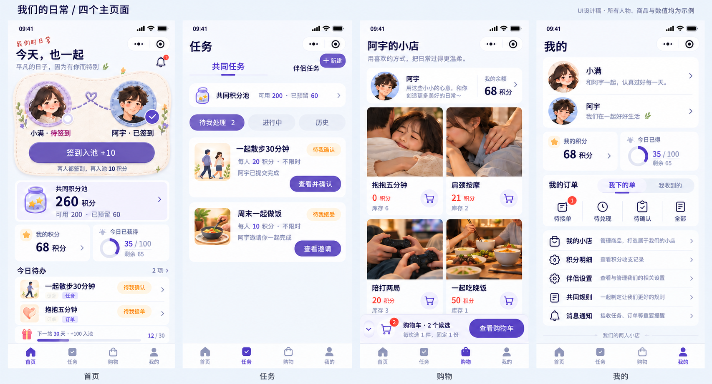
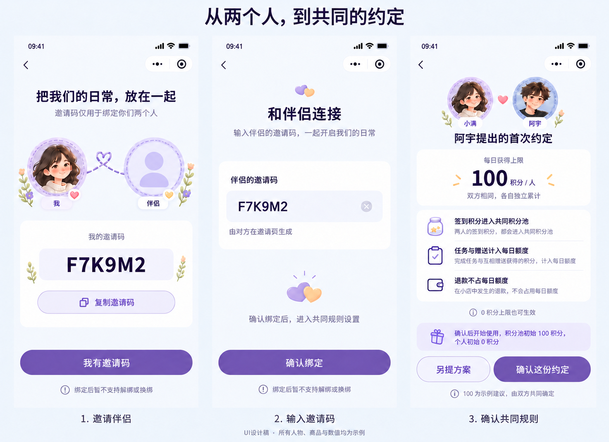
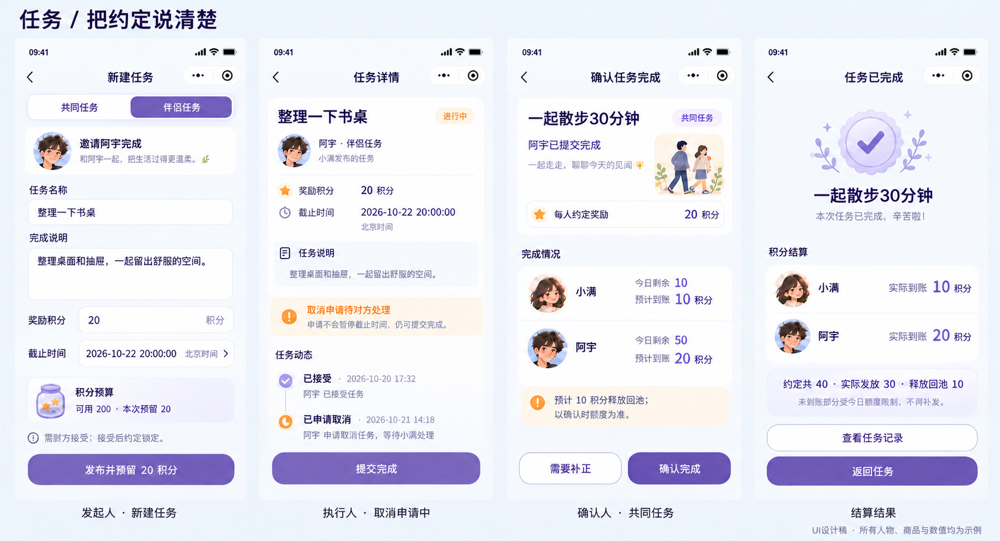
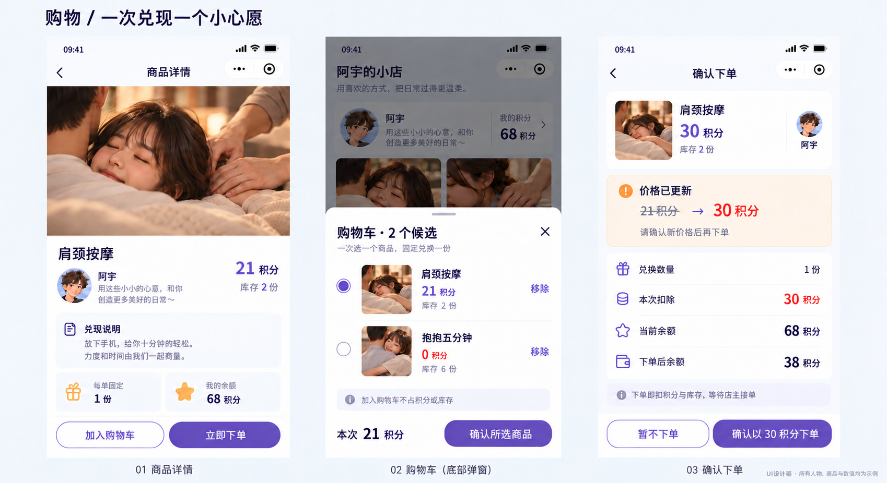
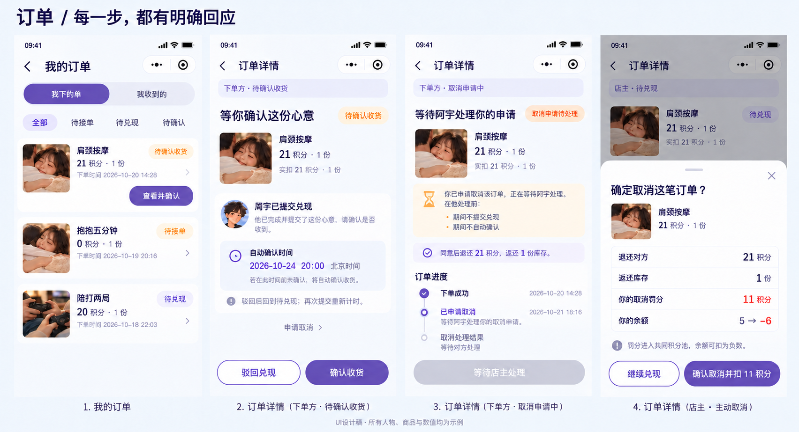
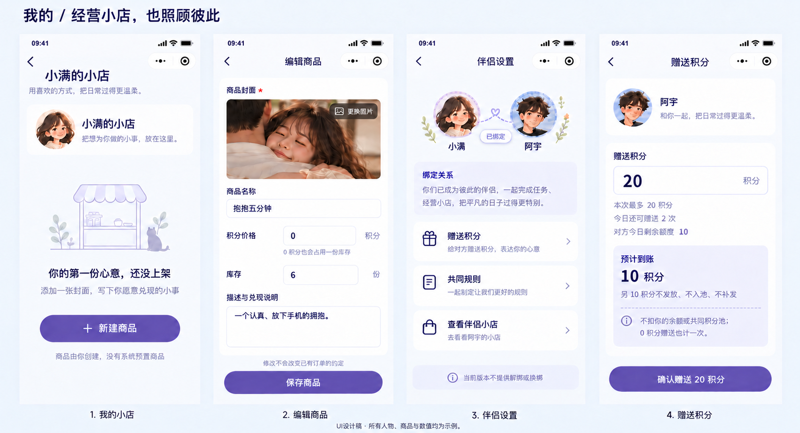
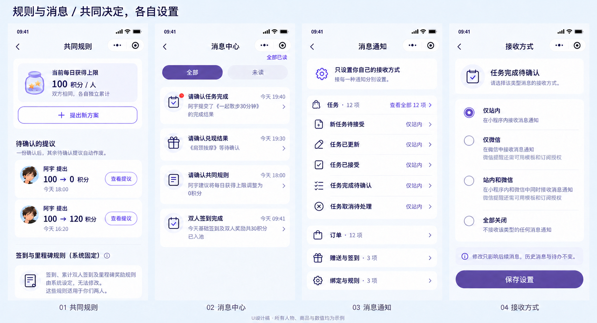
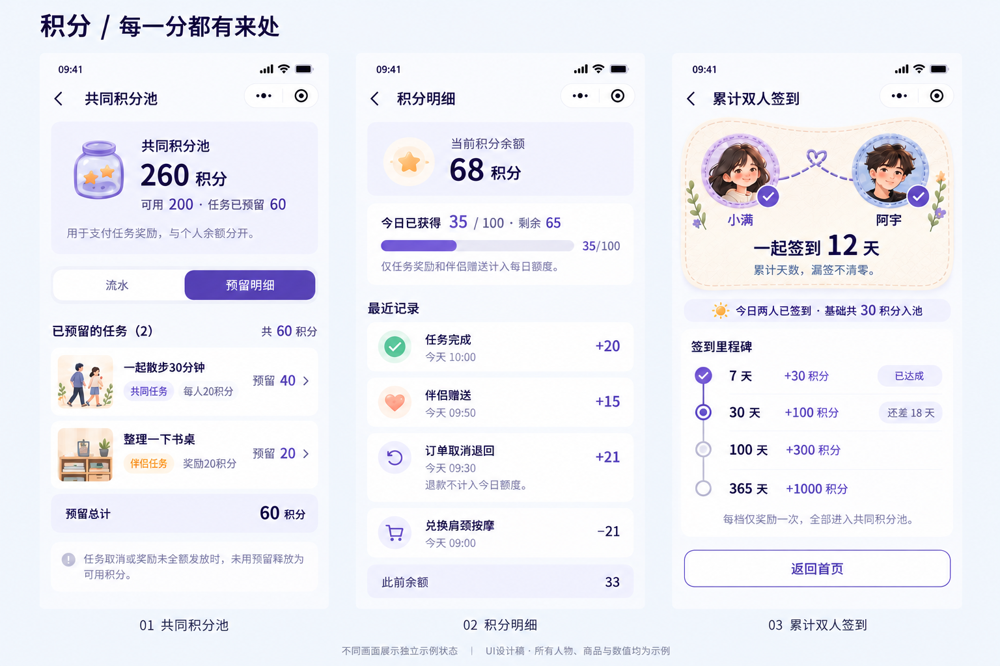

# UI 设计与交互评审

更新：2026-10-21。沿用已确认的 A「双人签到台」，交付 **8 张设计板、29 个页面与状态画面**，以及配套交互说明。用户已认可 v2 视觉方案，并补充了 [13 个开发图片素材](../../assets/ui/v1/README.md)；v1 视觉基准继续保留。

先看[四个主页面](images/v2/01-main-pages.png)，再按下面的流程查看。角色权限、状态变化、零值与异常分支见[交互说明 v2](interaction-spec-v2.md)。

图稿由内置 image_gen 生成并局部校正，属于静态设计评审图，不是可点击原型或已实现截图。所有人物、昵称、商品、邀请码与数值均为示例；不同画面可表示独立场景。真实小店从空白开始，个人初始 0 分，共同池初始 100 分；示例每日上限 100 需双方约定。

## 1. 四个主页面

首页、任务、购物、我的。首页保留双人签到台；购物车放在购物页内，四项底部导航不变。

## 2. 绑定与首次规则

邀请码邀请、输入邀请码、另一方确认共同规则。绑定前不显示未知伴侣身份；规则生效后才进入日常业务。

## 3. 任务创建与完成

创建伴侣任务、取消申请期间继续处理、共同任务完成确认、实际结算。图中每人约定 20，实际到账 10/20，剩余 10 释放回池。

## 4. 商品、购物车与改价确认

商品详情、购物页内单选购物车、改价后的确认页。每单一件一份；价格从 21 改为 30 时必须重新确认，当前价格、扣除和按钮一致。

## 5. 订单兑现与取消

双角色订单列表、确认收货、取消申请待处理、店主主动取消后果。图中原实扣 21，店主主动取消罚 11，余额 5 变为 -6。

## 6. 小店、伴侣与赠送

自己小店空态、商品编辑、伴侣设置、赠送积分。先显示预计到账和未发放部分；0 积分商品与赠送均有明确规则。

## 7. 共同规则与消息设置

当前规则与多份提议、消息中心、逐模板列表、单模板的四种渠道。共 30 个独立接收偏好，分组不代替具体模板设置。

## 8. 积分与签到记录

共同积分池及预留、个人积分流水、累计双人签到里程碑。三种数值分清：池子预算、个人余额、每日获得额度。

## 配套文件

- [前端架构方案](../frontend-architecture.md)：目录分层、页面路由、状态管理、接口协作与实施顺序。
- [UI 开发素材包](../../assets/ui/v1/README.md)：9 张透明插画与装饰、4 张可选封面，附预览页和引用清单。
- [交互说明 v2](interaction-spec-v2.md)：页面索引、布局目标、按钮权限、状态表、异常文案和实现验证边界。
- [图稿提示词与校正记录](image-prompts-v2.md)：完整生成提示词、参考图和各次局部修正。
- [设计核对记录](review-v2.md)：本轮静态核对结果及仍需真实前端验证的内容。
- [产品规格](../PRD.md)、[已选视觉方向](../../DESIGN.md)。

建议按“主页面 → 任务 → 购物/订单 → 设置”的顺序评审。正式名称、双方实际称呼与素材、表单长度限制、最终技术栈仍待实施准备；本轮 UI 不替这些事项作决定。

## v1 已确认基准与历史

用户已选择 A「双人签到台」。B、C 作为早期比较记录保留。

- [A 首页大图](images/home-detail-v2.png)
- [首页三种布局对比](images/home-comparison-v2.png)
- [原主要页面总览](images/screens-overview-v3.png)
- [原页面结构说明](home-ui-brief.md)
- [v1 生成提示词](image-prompts-v1.md)
- [v1 局部校正记录](image-corrections-v2.md)

本轮没有修改 PRD 或原图。v2 作为后续前端页面与状态的设计依据，业务语义仍以 PRD 为准。
