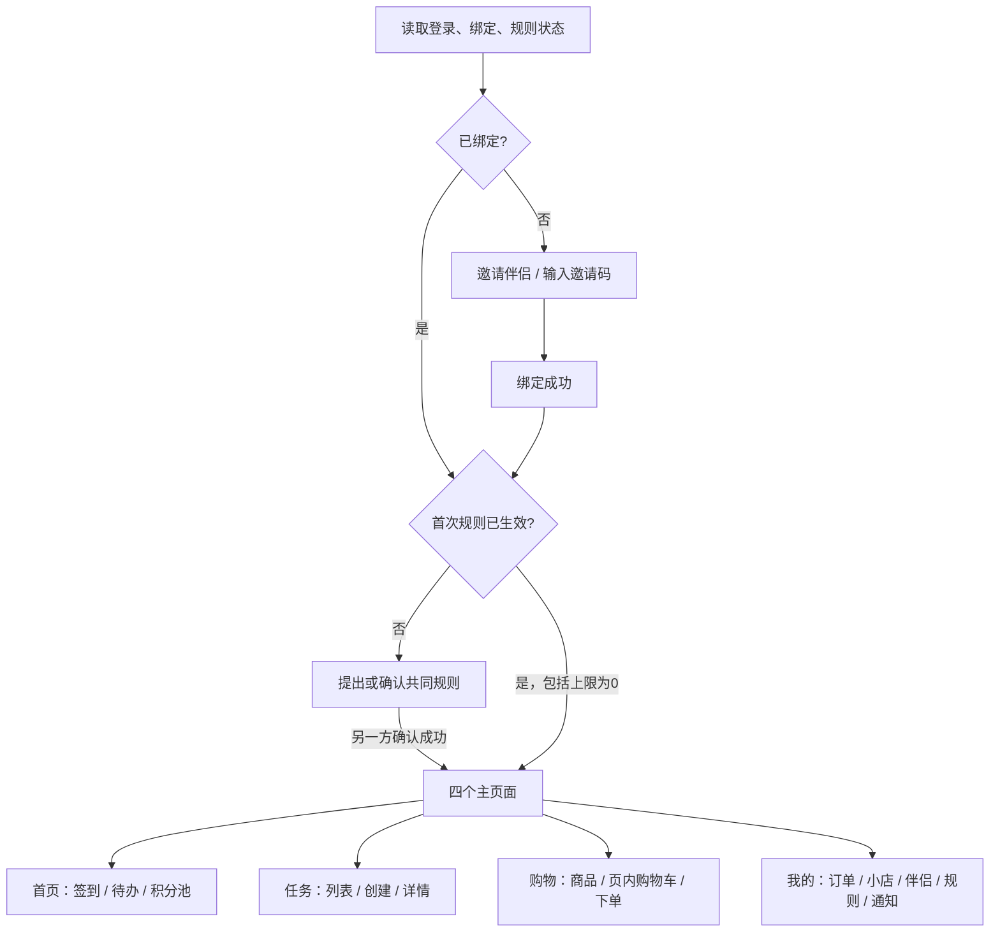

# 前端 UI 与交互说明 v2

状态：2026-10-21 设计评审稿。沿用已确认的 A「双人签到台」，本轮完善各页面设计图与交互说明，未实现小程序或后端。页面行为以 [PRD](../PRD.md) 为准；本稿的布局、字段组织和文案是供评审的 UI 方案。

## 1. 设计目标与范围

两个人在微信里短时间签到、处理约定、兑换互动。界面首先回答“现在是什么状态、轮到谁处理、操作后积分怎么变”。使用模式为 Operate。

- 首页保留双人签到这一视觉中心，接着呈现共同预算、个人额度和待办。
- 四个主入口固定为首页、任务、购物、我的。购物车属于购物页；伴侣设置属于我的。
- 角色根据当前操作决定，不绑定性别。小满、阿宇、头像、商品、邀请码和数值均为示例。
- 图稿用于确定层级与状态表达；真实文字、组件、素材在实现阶段重建，不把整张图作为页面底图。
- 图稿中的不同画面可以展示独立场景，不构成同一账户连续发生的一组交易。每日上限 100 只是示例，不是默认规则。
- 本轮不确定技术栈、接口字段长度、正式名称或真实头像；不增加聊天、纪念日、真实支付、公开市场、催办和解绑。

## 2. 图稿与页面索引

每张设计板从左到右对应下表页面。共 8 张板、29 个页面/状态画面；未单独绘制的分支按后文状态表复用页面结构。

| 设计板 | 页面编号与内容 |
| --- | --- |
| [01 四个主页面](images/v2/01-main-pages.png) | H01 首页；T01 任务列表；S01 购物；M01 我的 |
| [02 绑定与首次规则](images/v2/02-onboarding-rules.png) | B01 邀请伴侣；B02 输入邀请码；R01 首次规则确认 |
| [03 任务流程](images/v2/03-task-flow.png) | T02 新建任务；T03 进行中与取消申请；T04 完成确认；T05 结算结果 |
| [04 购物下单](images/v2/04-shopping-checkout.png) | S02 商品详情；S03 页内购物车；S04 改价后的下单确认 |
| [05 订单流程](images/v2/05-order-flow.png) | O01 订单列表；O02 待确认收货；O03 取消申请待处理；O04 店主主动取消确认 |
| [06 小店与伴侣](images/v2/06-store-partner.png) | M02 我的小店空态；M03 商品编辑；P01 伴侣设置；P02 赠送积分 |
| [07 规则与消息](images/v2/07-rules-notifications.png) | R02 共同规则；N01 消息中心；N02 通知设置列表；N03 单模板接收方式 |
| [08 积分与签到](images/v2/08-points-checkin.png) | I01 共同积分池；I02 个人积分明细；H02 累计签到与里程碑 |

## 3. 页面结构与返回路径

主页面使用四项 Tab。二级页面使用返回箭头；二级详情和表单不叠加 Tab。O01 订单列表、M02 我的小店从“我的”进入，左上角返回“我的”。购物车是购物页内的半屏弹层，不创建第五个 Tab。关闭弹层回到原商品浏览位置，表单键盘不遮挡当前输入和主要动作。

已登录但尚未绑定时进入 B01/B02。邀请码未验证前，不显示已知伴侣的头像或昵称。绑定后的 R01 才展示双方真实资料。邀请码格式、有效期与刷新规则尚未定义，图示不把六位长度或过期倒计时设成业务约束。

首次规则未生效时，启动页及业务深链进入规则流程，不执行签到、赠送、任务发布或下单。已有规则后的修改提议不阻断日常功能。判断是否开放业务使用“已生效”状态，上限为 0 仍正常开放。

首次 R02 消息进入其对应提议详情并保留提议 ID；R01 的伴侣设置入口先完成首次规则，再恢复目标。消息、伴侣设置等日常页面沿用同一门禁，不因消息跳转放开赠送或购物。跳转被门禁拦截时，不提前把该消息标为已读。

首次提议详情成功打开后，可以标读对应的本人站内 R02 消息，不开放整个消息列表；仅微信提醒且没有站内记录时，不新建站内消息。

从待办、消息、订单或积分流水进入同一个业务详情；返回原入口和列表位置。旧通知保留当时正文，详情显示当前状态，不重现失效按钮。

## 4. 视觉与组件规范

### 4.1 延续 A 的视觉语言

冷白底、鸢尾紫操作色、深紫文字。成对织标头像集中用于首页签到与关系页；表单、列表、金额后果说明保持平整、清楚。图稿里的轻微材质表现不扩展成全站装饰。

以下为后续实现的目标值，不表示已从生成位图中逐像素提取：

| 角色 | 目标值 / 用法 |
| --- | --- |
| 页面背景 | `#F6F7FC` |
| 内容表面 | `#FFFFFF` |
| 主文字 | `#29223B` |
| 次级文字 | `#71677E`，承担说明而不承担禁用感 |
| 主要操作 | `#6752A3` 配白字 |
| 浅紫选中底 | `#EEEAF6` 配主色文字 |
| 分隔线 | `#E4DFED` |
| 警告 | `#92501B` 配 `#FFF4E7`；需说明具体后果 |
| 错误 / 扣罚 | `#A6403E` 配 `#FFF3EF`；不能只靠红色表达 |
| 成功 | `#2C6C58` 配 `#EDF6F1` |

中文系统无衬线字体；页面标题约 22–24px、区块标题 17–18px、正文/按钮 15–16px、辅助信息 12–13px。关键金额用字号和字重区分，不靠巨大数字挤压状态说明。积分统一写“积分”，不使用货币符号或店铺收入语义。

按 390px 逻辑宽度设计，内容边距 16px，控件间距使用 4/8/12/16/24。普通表面圆角 12–16px；主要按钮高 48px；图标按钮触控区域至少 44×44px。底部操作区额外留出系统安全区，滚动内容预留操作区高度。

### 4.2 共用交互

| 组件 | 行为 |
| --- | --- |
| 主按钮 | 每个操作区域只有一个主要动作；提交后显示“提交中…”并禁止重复点击 |
| 次按钮 | 用于明确备选动作；“需要补正”“暂不下单”等名称描述结果 |
| 状态标签 | 文字说明阶段，颜色仅作辅助；“待我确认”和“等待对方确认”区分责任 |
| 行列表 | 标题、状态、主要数值、辅助时间；整行进入详情，避免同一行叠多个重复入口 |
| 表单 | 标签常驻；错误放在对应字段下；保留输入；提交失败不清空 |
| 结果反馈 | 轻操作可用短反馈；涉及到账、退款、扣罚用持久结果区域或详情记录 |
| 确认弹层 | 用于取消扣罚等需看清后果的动作；不把所有详情和表单都做成弹层 |
| 加载与失败 | 首次读取用与内容同形的占位；局部刷新保留已读内容；失败显示原因与重试 |
| 空态 | 说明为什么为空和可做什么；伴侣店为空时不提供代替对方创建商品的按钮 |
| 长内容 | 标题允许两行，详情可完整展开；状态、积分、截止时间和主要按钮不截断 |
| 大字体 / 窄屏 | 信息横排可改纵排，两个操作可纵向排列；购物卡不足以承载文字时改为单列 |

通知铃不进入微信右上角胶囊的点击区。图稿中仅首页展开消息入口，其他主页面可用同一工具位复用；“我的 → 消息通知”进入偏好设置，不冒充消息中心。

主文字/背景对比目标至少 4.5:1，大字至少 3:1；状态兼有文字和图形。输入错误关联字段，图标有可读名称。实现时另验读屏、焦点、动态文字和触控；位图不能代替这些验证。

## 5. 首页、签到与积分

### 5.1 H01 首页

顺序固定为：问候与消息入口 → 双人签到台 → 共同积分池 → 个人余额/今日额度 → 今日待办 → 累计里程碑。

- 签到只操作本人。未签到头像无勾，已签到显示勾和“已签到”，不靠颜色区别。
- “签到入池 +10”中的 10 是本人的基础贡献。若本次达成双人签到，结果写“本次共 20 积分入池：签到 10 + 双人奖励 10”。
- 如同时达成里程碑，再单独列该档额外奖励；当天基础合计 30 不包含里程碑。
- 池子显示总额、可用和预留，并保证总额 = 可用 + 预留。
- 余额是可消费积分；“今日已获得 / 上限”是当天实际到账。上限降到已得以下时，显示真实已得及“剩余 0”，不能缩减历史已得。
- 待办来自当前业务状态，不取决于是否开启消息。只列需要当前用户处理的任务、订单和规则提议；等待对方的事项在业务列表查看。
- 待办为空时写“今天的待办都处理好了”。首页不放商品墙或商家收入。

| 签到状态 | 展示与可用操作 |
| --- | --- |
| 双方未签 | 两个未签到状态；本人签到按钮可用 |
| 本人未签、对方已签 | 图稿主状态；说明本次签完将达成双人签到 |
| 本人已签、对方未签 | 本人按钮“今日已签到”不可重复；显示“等对方签到” |
| 双方已签 | 双勾；今日基础 30 分入池；无重复领取按钮 |
| 首次使用 | 个人 0、池子 100、累计 0；无伪造历史或预置任务 |
| 跨北京时间零点 | 重新读取当天签到与额度，累计天数不归零 |

H02 展示累计双人签到天数、下一档距离和 7/30/100/365 天四档奖励。已获档位只标“已达成”，不重复出现领取按钮。文案始终为累计，不出现连续、断签或补签。

### 5.2 I01 / I02 积分明细

共同积分池详情分“流水”和“预留明细”。预留记录关联任务，说明共同任务为两人合计；释放预留只是从预留转为可用，不画成池子额外新增一笔奖励。

个人明细展示余额、今日获得和带原因的收支。每条可进入原订单、任务或赠送记录；退款不占额度，商品消费不会成为店主收入。罚分后显示负号，不用 0 覆盖负余额。

赠送为 0、任务实际到账为 0 仍有业务结果记录。积分明细可展示 0 变动及原因，不能因为数值为 0 就无法查看记录。本人签到只在池子记录，不画在个人收入中。

## 6. 任务

### 6.1 T01 列表

第一层区分共同任务/伴侣任务；第二层为“待我处理 / 进行中 / 历史”。这里“进行中”是未结束事项的集合，列表行仍标明真实阶段；等待对方接受或确认也可在此查到。历史包含完成、拒绝、取消、未接受到期和已接受超时，不能只保留成功记录。

共同任务显示“每人 X 积分 · 不限时”；伴侣任务显示执行人、奖励及完整截止时间。任务详情的有效截止时间使用“YYYY-MM-DD HH:mm:ss 北京时间”，不以倒计时取代日期。

### 6.2 T02 创建与编辑

| 字段 | 共同任务 | 伴侣任务 |
| --- | --- | --- |
| 类型 | 共同任务 | 伴侣任务 |
| 参与者 | 固定双方 | 固定为创建人的伴侣，不可选择自己 |
| 名称、完成说明 | 描述约定 | 描述约定 |
| 奖励 | 明确标“每人奖励” | 明确标“执行方奖励” |
| 截止时间 | 不显示输入框，固定“不限时” | 必填未来绝对时间 |
| 预算预览 | 每人奖励 × 2 | 执行方奖励 |
| 主按钮 | 发布并预留 X 积分 | 发布并预留 X 积分 |

名称与完成说明的具体长度由前后端契约确定，本稿不增加 20/30/100/200 字等限制。不可把空输入当成 0；明确输入 0 为有效奖励。

金额先检查非负，再按 PRD 四舍五入为整数，展示取整结果后用于提交；不能先取整再放行负数。库存是非负整数，不能接受小数。截止时间选择到分钟时明确显示秒为 00，提交必须严格早于该时刻。

池子不足时，在预算附近显示“需预留 X，可用 Y”，保留表单并阻止发布。奖励 0、池子可用 0 时仍可发布。接受前，创建方可编辑约定、奖励和未来截止，预览预留差额；接受后详情只读，不出现修改原约定按钮。

### 6.3 T03–T05 主阶段与操作权限

| 主阶段 | 当前用户与操作 | 积分/时间提示 |
| --- | --- | --- |
| 待接受 | 创建方：编辑；另一方：接受或拒绝 | 已预留，未到账；接受不顺延截止 |
| 进行中 · 伴侣任务 | 执行方提交完成；创建方查看 | 有效截止前提交；提交本身不发分 |
| 进行中 · 共同任务 | 任一方可提交完成 | 不限时 |
| 待确认完成 | 本次提交人的另一方确认或驳回；提交人等待 | 及时提交的伴侣任务不再因原截止过去而超时 |
| 需要补正 · 伴侣任务 | 执行方按新期限重新提交 | 驳回时确认方必须指定未来补正截止 |
| 需要补正 · 共同任务 | 任一方按权限重新提交，另一方确认 | 仍不限时，保留预留 |
| 已完成 | 查看结算和历史 | 约定奖励、实际到账、未发放释放分别展示 |
| 已拒绝 / 已取消 | 仅查看 | 未发放预留全退，不罚 |
| 未接受到期 | 仅查看 | 退池，不罚 |
| 已接受超时 | 仅查看，不能补交 | 退预留；执行方罚奖励的 50%，取整，可扣负 |

接受/拒绝/提交/确认都以当前状态校验；另一方先处理后，本地旧按钮显示“状态已更新”，重新读取，不重复结算。

完成确认页展示双方适用的“预计到账”，提示以确认时额度为准。结果页展示已经发生的“实际到账”。共同任务奖励相同而实际到账可以不同，例如每人约定 20、剩余额度 10/50，则到账 10/20、预留释放 10；不显示“双方各到账 20”。

驳回面板复用详情结构。伴侣任务必须显示新的补正截止输入及“确认驳回并设置新期限”；共同任务不出现日期输入。PRD 未要求的照片证据、强制备注不设为提交门槛。

### 6.4 取消申请是独立状态

T03 在主阶段上方显示取消申请条，不用“取消中”替换主阶段。

| 申请状态 | 展示与交互 |
| --- | --- |
| 无申请 | 未结束任务的双方均可从次级操作申请取消 |
| 本人已申请 | “等待对方处理取消申请”；不再新建第二份；主阶段允许的操作保留 |
| 对方已申请 | “同意取消 / 拒绝取消”；同时保留主阶段下本人有权执行的操作 |
| 同意取消成功 | 任务结束，释放预留，无罚分；关闭其他完成操作 |
| 拒绝取消 | 仅关闭该申请；保留处理时的最新主阶段和最新有效截止 |
| 任务先结束 | 申请自动失效，移除同意/拒绝入口，展示实际结束结果 |

已接受且尚未提交的伴侣任务必须写“申请不会暂停截止时间，仍需在…前提交”。取消申请期间仍可接受、拒绝任务、提交、确认或驳回完成。若申请后已及时提交，再拒绝取消，仍停在待确认；不能退回进行中。若已驳回并产生新截止，拒绝取消不能恢复旧截止。到期后先展示到期结果，不能用同意取消规避已发生的超时。

## 7. 购物与下单

### 7.1 S01 / S02 浏览与详情

购物只展示伴侣小店；自己店的管理入口在我的。商品显示必需的单张封面、名称、积分价、库存和兑现说明；不引入规格、地址、预约时间、数量选择或轮播图功能。

库存为 0 时显示“暂无库存”，保留详情浏览、禁用下单。余额不足时在价格/下单区说明；负余额时，即使价格为 0 也不能下单。余额为 0 且商品为 0、库存充足，则可正常下单。

伴侣店为空时显示“对方的小店还没有商品，等第一份心意上架”。不提供创建伴侣商品、自动添加模板商品或额外催办通知。

### 7.2 S03 页内购物车

购物车保存多个候选，每行提供单选圆点及移除。没有全选、复选、数量加减和合计所有候选金额。未选商品时主按钮不可用，显示“选择一个商品”；选中后显示该商品一份的积分。

加入购物车不扣积分、不占库存。库存耗尽、商品不可用、价格变更均在打开时刷新并逐项说明；失效项保留可移除入口，不能下单。成功下单后可从当前候选中移除该商品，其他候选保留；该移除行为作为 UI 提案，具体购物车持久化约定在实现时统一。

### 7.3 S04 确认与结果

确认页呈现当前商品、固定 1 份、实扣积分、当前余额、预计扣后余额和“下单即扣积分与库存，等待店主接单”。任何价格变化都同时显示旧价和新价，原确认失效；新价格在商品摘要、明细和按钮中一致。

主按钮采用“确认以 X 积分下单”。价格不一致不能自动按新价重试，不能用一次通用弹窗认可今后的所有改价。

进入购物、回前台、打开商品/购物车、进入确认页时刷新；相关页面可见时按 PRD 每 30 秒刷新，隐藏时停止。最终仍依据服务端最新价格、库存和余额，先处理到期任务可能带来的罚分。

| 下单结果 | 页面行为 |
| --- | --- |
| 成功 | 进入订单详情“待接单”，显示实扣和剩余余额；0 分订单也已占用 1 份库存 |
| 价格变化 | 显示旧/新价，更新当前价格和预算；重新明确确认 |
| 库存不足 | “刚刚没有库存了”，取消可下单状态，返回可继续浏览 |
| 积分不足 | 显示当前余额和所需积分；仍保留商品信息 |
| 余额为负 | “当前余额为 -X，恢复至非负后才能下单”；0 分商品同样禁用 |
| 网络失败且确定未提交 | 保留所选商品，允许重试 |
| 请求结果未知 | 持久显示“正在确认下单结果”，查询原操作；不新增一笔订单或因改价直接创建新请求 |

请求身份和去重键是实现细节，不出现在产品文案中。确认未知结果后，才根据已经成功/确定未创建决定进入订单或重新确认。

恢复的成功回执可能早于订单当前状态。例如原下单后来已经取消，页面应保留本次下单结果说明，再展示当前已取消详情和最新余额，不重新显示待接单或提供失效按钮。若需结束无法确认的原请求，须由后端保证原请求已关闭且不会再生效，之后才允许重新确认提交。

## 8. 订单

O01 通过“我下的单 / 我收到的”切换角色视角，状态筛选使用待接单、待兑现、待确认及全部；全部包含已完成、已拒绝和已取消历史。订单以创建时商品快照展示，编辑商品不会改变原订单的图片、约定或价格。

| 订单阶段 | 下单方 | 店主 |
| --- | --- | --- |
| 待接单 | 查看、直接取消 | 接单、拒单 |
| 待兑现 | 查看、申请取消 | 提交已兑现、主动取消 |
| 待确认收货 | 确认收货、驳回兑现、申请取消 | 查看、主动取消 |
| 取消申请待处理 | 等待店主处理 | 同意或拒绝取消申请；仍可按规则主动取消并承担罚分 |
| 已完成 / 已拒绝 / 已取消 | 查看结果与历史 | 查看结果与历史 |

### 8.1 兑现确认

店主提交已兑现后，下单方进入 O02。显示本轮完整自动确认时间“YYYY-MM-DD HH:mm 北京时间”；按钮为“驳回兑现 / 确认收货”。每轮为提交后 3 天，不写成“今晚自动收货”。

驳回后回到待兑现，本轮自动确认失效；再次提交重新计算 3 天。成功反馈与历史记录保留是谁、何时操作，不能显示已经失效的倒计时。

### 8.2 取消与扣罚

| 行为 | 确认内容 |
| --- | --- |
| 接单前下单方取消 / 店主拒单 | 退实扣积分、返还 1 份库存，无罚分 |
| 下单方接单后申请取消 | 先显示等待店主处理；不立即宣称退款 |
| 店主同意下单方申请 | 退实扣积分、返还库存，双方不产生主动取消罚分 |
| 店主拒绝取消 | 原待兑现继续待兑现；原待确认从拒绝时重新给予 3 天，并明确新日期 |
| 店主主动取消 | 退对方实扣积分、返还库存，另扣店主原实扣价 50%，取整并入池 |

O03 与任务取消不同：订单取消待处理期间不提交已兑现，也不自动完成。页面用等待状态替换相应主操作，旧的自动确认时间不能继续作为有效倒计时展示。

O04 为店主主动取消的后果确认。示例实扣 21，罚 11；店主余额 5 扣至 -6。不得使用商品当前改价后的 100 计算罚分。按钮明确写“确认取消并扣 11 积分”，不只写“确定”。若实扣 0，文案为“本单为 0 积分，无需退分；取消罚分 0”，仍返还库存。

## 9. 我的、小店与伴侣

### 9.1 M01–M03

我的页顶部是本人资料、余额和今日额度，随后是双角色订单、自己小店、积分明细、伴侣设置、共同规则和通知设置。

M02 空店提供“新建商品”。有商品时复用商品行：封面、名称、积分价、库存和“编辑”；无库存并不等于自动删除。不增加收入/销量排行、上下架审批或删除历史订单功能。

M03 字段为商品封面、名称、积分价格、库存、描述与兑现说明。封面必须完成选择和上传后才可保存；上传失败保留其他字段并允许重试。支持从设备选取单张图片，系统素材入口待素材准备后再补。

新建表单不填入示例商品。价格可以为 0；库存为非负整数。编辑保存前说明“不改变已有订单的约定”。名称、说明的最终字段约束及图片限制在实现准备阶段确定，不以图稿推导最大长度。

个人头像/昵称若提供编辑入口，采用本人资料表单；不编辑伴侣资料。本稿沿用已有个人资料能力，不增加关系纪念日等字段。

### 9.2 P01 / P02

伴侣设置显示绑定双方及只读关系，入口为赠送积分、共同规则、查看伴侣小店；不提供解绑、换绑或替对方调整通知。

赠送页面显示接收人、今日剩余次数、按对方当前上限计算的单次最多值、对方剩余额度和预计到账。单次上限为每日上限五分之一再四舍五入，不能固定成 20。

赠送 20、对方剩余 10 时，写“预计到账 10，另 10 不发放、不入池、不补发”。说明不扣赠送方余额或共同积分池。提交后显示实际到账与剩余次数，以最终结果为准。

| 边界 | 交互 |
| --- | --- |
| 输入 0 | 允许提交，并提示“本次仍计入赠送次数” |
| 对方额度为 0 | 可按有效单次上限赠送，预计到账 0；不伪装成失败 |
| 对方每日上限 0、1、2 | 单次上限为 0，允许 0 分赠送 |
| 已用 3 次 | 禁用提交，显示“今天的 3 次赠送已用完” |
| 负数 / 超过单次上限 | 字段提示，拒绝提交 |
| 成功但到账为 0 | 保留赠送记录；主动赠送 0 不误报额度不足 |
| 结果未知 | 确认原操作结果，不能重新消耗一次赠送机会 |

## 10. 共同规则与消息

### 10.1 R01 / R02

首次由一方填写每日上限并提出，另一方确认。提出人只看到“等待对方确认”；不能用同一按钮确认自己的提议。不认可时提供“另提方案”，不增加 PRD 未定义的拒绝/撤回提议流程。

已有规则时，R02 先显示当前生效值，再列每份待确认提议的提出人、提议时原值、新值和时间。点击进入独立提议详情，确认明确针对这一份。修改内容创建新提议，不覆盖已有内容。

- 任何非负上限包括 0 都能被确认。
- 成功后立即显示新规则，并说明“今日已获得和赠送次数不重置”。
- 有其他待确认提议时说明“其余待确认提议已自动作废”。
- 打开作废提议时，展示原提议和当前规则，移除确认操作，提供“查看当前规则”。
- 当前生效值变了但本页未刷新时，先读取最新状态，不能再次确认已作废提议。
- 系统固定签到和里程碑以只读说明呈现，没有编辑开关。

### 10.2 N01 消息中心

消息使用事件流列表，显示标题、正文摘要、发生时间、未读状态和业务入口。默认按发生时间倒序；“全部/未读”和“全部已读”为页面操作，不删除历史。读取旧消息仍跳转当前业务详情。

“全部已读”仅覆盖该次操作确定的已入站消息；此前业务发生、此后才异步到达的消息仍为未读。列表展示顺序与已读范围分别处理。

消息全文展示 PRD 第 6 节对应的实际结果；列表可以摘要，但任务截止完整到秒、订单自动确认到分的关键时间在详情不能遗漏。不要新增一条重复的“积分变动”消息。图示“今天 HH:mm”仅为列表辅助时间，完整记录使用北京时间。

站内渠道关闭不会隐藏首页待办。微信发送失败也不会撤销已经完成的业务；没有站内授权偏好时，不自动改投站内。

### 10.3 N02 / N03 逐模板偏好

分组用于寻找模板，组标题没有总开关。N02 的任务分组展示五条预览，明确提供“查看全部 12 项”；点击后进入可滚动的完整任务模板列表。其他分组入口同样进入该组完整列表，显示全部 12/3/3 项；返回后保留原列表位置。每个具体模板有独立详情和四种选择：仅站内、仅微信、站内和微信、全部关闭。默认仅站内。以下 30 个模板都必须可到达，不能只实现图中五条预览：

| 分组 | 编号 | 页面展示名称 |
| --- | --- | --- |
| 订单 | O01 | 新订单待接单 |
| 订单 | O02 | 订单已接单 |
| 订单 | O03 | 订单被拒绝 |
| 订单 | O04 | 下单方直接取消 |
| 订单 | O05 | 订单待确认收货 |
| 订单 | O06 | 兑现被驳回 |
| 订单 | O07 | 下单方确认收货 |
| 订单 | O08 | 订单自动完成 |
| 订单 | O09 | 订单取消待处理 |
| 订单 | O10 | 订单取消获同意 |
| 订单 | O11 | 订单取消被拒绝 |
| 订单 | O12 | 店主主动取消 |
| 任务 | T01 | 新任务待接受 |
| 任务 | T02 | 待接受任务已更新 |
| 任务 | T03 | 任务已接受 |
| 任务 | T04 | 任务被拒绝 |
| 任务 | T05 | 未接受任务到期 |
| 任务 | T06 | 任务完成待确认 |
| 任务 | T07 | 任务完成被驳回 |
| 任务 | T08 | 任务完成结算 |
| 任务 | T09 | 已接受任务超时 |
| 任务 | T10 | 任务取消待处理 |
| 任务 | T11 | 任务取消获同意 |
| 任务 | T12 | 任务取消被拒绝 |
| 赠送与签到 | P01 | 收到伴侣赠送 |
| 赠送与签到 | P02 | 伴侣已签到 |
| 赠送与签到 | P03 | 双人签到里程碑 |
| 绑定与规则 | R01 | 伴侣绑定成功 |
| 绑定与规则 | R02 | 共同规则待确认 |
| 绑定与规则 | R03 | 共同规则已生效 |

表中编号仅供设计/开发对照，产品 UI 显示中文名称。部分图稿为简短列表名称，例如“任务已更新”，与同一模板对应，不新增模板。

选择微信渠道是接收偏好，不等于已获订阅授权。模板不可用或没有授权时，展示“微信提醒暂不可用 / 尚未获得订阅授权”及平台允许的下一步，不能显示已成功投递；保存偏好与平台授权结果分别反馈。未获授权不偷偷改成“仅站内”。修改只影响后续消息，历史不变、旧消息不补发。

## 11. 关键异常与文案

| 场景 | 首要反馈 | 可执行下一步 |
| --- | --- | --- |
| 邀请码不可用 / 已使用 | “这个邀请码暂时无法绑定”并显示服务端可公开的具体原因 | 保留输入，检查邀请码 |
| 初次无数据 | 当前真实初始余额和空态 | 完成规则、创建商品或发起任务 |
| 数据加载失败 | “暂时没能加载，请重试” | 重试读取，不展示假成功 |
| 提交重复点击 | 按钮“提交中…” | 等待同一次操作结果 |
| 原请求结果未知 | “正在确认操作结果” | 查询/重试原操作，不另建业务 |
| 另一方已处理 | “状态已更新” | 更新详情与可用操作 |
| 任务池不足 | “本次需预留 X，可用 Y” | 修改奖励，保留其他输入 |
| 截止恰好到达 | 任务到期/超时结果与实际积分后果 | 查看记录，不能继续提交或顺延 |
| 伴侣任务驳回未填未来截止 | “请设置晚于当前时间的补正截止” | 修改该字段 |
| 共同任务驳回 | “请补正后重新提交，仍不限时” | 返回可提交阶段 |
| 负余额下单 | “当前余额为 -X，恢复至非负后才能下单” | 继续浏览或查看积分明细 |
| 规则提议已作废 | “这份提议已作废，当前上限为 X” | 查看当前规则 |
| 获得额度已满 | 明确实际到账 0，解释未发放的去向 | 查看任务/赠送结果，不要求重新领取 |
| 图片选择/上传失败 | 图片字段错误，保留表单 | 重新选择或上传 |
| 通知全部关闭 | 此模板标“全部关闭” | 可改偏好；业务待办照常 |

## 12. 本轮核对与后续实现验证

静态设计核对重点：

- 四 Tab、页内单选购物车、每单一份、封面必选；无真实金钱和未要求的功能入口。
- 积分池 260 = 可用 200 + 预留 60；个人余额与每日额度分开；预留释放不重复加总。
- 共同任务结算 40 = 实际发放 30 + 释放 10；个人各到账 10/20。
- 订单原价 21 的取消罚分 11；余额 5 → -6；同意下单方取消不罚。
- 改价例 21 → 30，确认页当前价格/扣除/按钮一致，余额 68 → 38。
- 通知为 12 订单 + 12 任务 + 3 积分签到 + 3 绑定规则，共 30 个独立偏好。
- 签到为累计；7/30/100/365 的奖励分别 30/100/300/1000。
- 图片中的名称、数据和照片均为设计示例；新建小店为空。

实施阶段需要额外验证：320–430px 的窄屏、大字体与键盘遮挡；微信胶囊/安全区；真实长文案、头像与图片加载；逐角色按钮权限；跨零点、并发状态更新、请求结果未知、实际订阅能力及 PRD 第 8.8 节业务场景。这些不属于本轮静态图稿已验证的内容。
